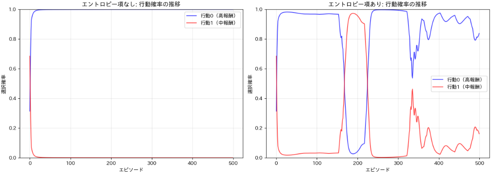
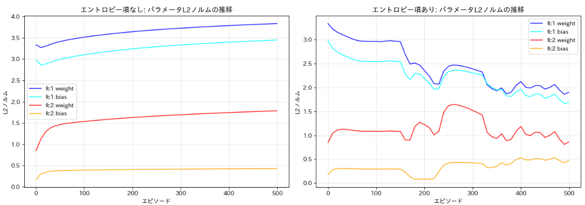
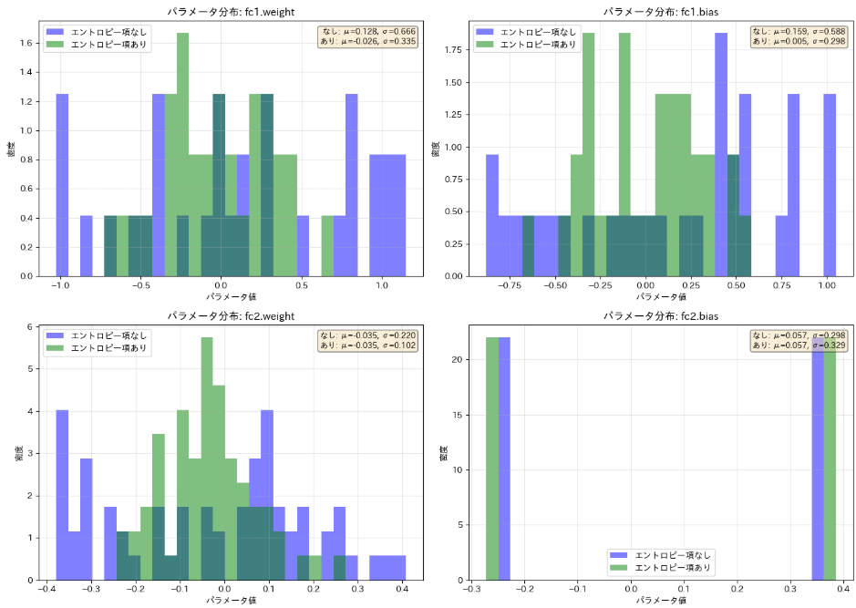

[先日のエントロピによる強化学習の探索促進](https://yoshishinnze.hatenablog.com/entry/2026/12/10/043000)について、今回は実験によって効果を確認してみようと思います。


## 実験の問題設定

今回実験で知りたいことをは、**「強化学習で『探索を促すエントロピー正則化』を入れると、ニューラルネットの重み（パラメータ）の分布がどう変わるのか？」** の検証結果です。

以下、3つの観点で整理します。

### 1. 検証したい問い

強化学習では、エージェントが「この行動が一番良い」と早々に決めつけると、他の行動を試さなくなり、**局所最適にハマってしまいます**。これを防ぐため、損失関数に「行動の多様性を保つ」エントロピー正則化項を加えます。

しかし、**この正則化項が、ニューラルネットの中身（重みやバイアスの数値分布）にまで影響を与えるのか？** 与えるとすれば、どんな違いが出るのか？ これが本実験の核心です。

### 2. 実験条件（シンプルに設計されています）

| 項目 | 内容 |
|---|---|
| **環境** | 2つの行動だけの「バンディット」環境（スロットマシン的なもの） |
| **行動と報酬** | 行動0（右）→ 期待報酬 **1.0**、行動1（左）→ 期待報酬 **0.6** |
| **エージェント** | MLP（入力1次元 → 隠れ層32 → 出力2） |
| **学習方法** | REINFORCE（方策勾配法） |
| **比較パターン** | ① エントロピー項なし（`c=0.0`）／ ② エントロピー項あり（`c=0.3`） |

環境を極力シンプルにしたのは、**「エントロピー項以外の要因を排除し、純粋に正則化の効果だけを見るため」** です。

### 3. 何を観察するか

学習中・学習後に、以下を記録・可視化します。

- **行動確率の推移**：高報酬の行動0にどれだけ速く偏るか
- **エントロピーの推移**：行動の迷い（多様性）がどれだけ保たれるか
- **パラメータの分布**：fc1（隠れ層）とfc2（出力層）の**重み・バイアスのヒストグラム・箱ひげ図・標準偏差の推移**

## 実験コード

今回検証する実験コードは **「環境」「ネットワーク」「監視対象」** の3つで構成されています。以下にそれぞれを解説し、特にロス関数の部分を重点的に説明します。

### 1. 環境（SimpleBanditEnv）

```python
class SimpleBanditEnv:
    def __init__(self):
        self.rewards = [1.0, 0.6]  # 行動0: 1.0、行動1: 0.6
```

**これは「2つのボタンがあるスロットマシン」です。**

- ボタン0（右）を押すと平均**1.0**の報酬
- ボタン1（左）を押すと平均**0.6**の報酬

状態（観測）は常に同じ値（`[[1.0]]`）を入力するダミーです。これにより、**「エージェントが観測から判断する」という複雑さを排除し、純粋に『行動選択の学習』だけに集中**できます。

### 2. ネットワーク（PolicyNetwork）

```python
class PolicyNetwork(nn.Module):
    def __init__(self):
        self.fc1 = nn.Linear(1, 32)   # 入力1 → 隠れ層32
        self.fc2 = nn.Linear(32, 2)    # 隠れ層32 → 出力2（行動0と行動1のlogits）

    def forward(self, x):
        x = torch.tanh(self.fc1(x))  # 隠れ層にTanh活性化
        logits = self.fc2(x)           # 生の出力（Softmax前のスコア）
        return logits
```

**2層のMLP（全結合ネットワーク）**です。

- 入力は常に `[[1.0]]`（ダミー）
- `fc1` で32次元の中間表現に変換し、`fc2` で「行動0の得点」「行動1の得点」の2つの **logits** を出力
- この logits に **Softmax** をかけることで、行動選択確率（`[0.5, 0.5]` など）に変換します

### 3. 監視対象（何を記録するか）

学習中に以下を**エピソードごと**に記録しています。

| 記録項目 | 内容 |
|---|---|
| `probs_0`, `probs_1` | 各行動の選択確率の推移 |
| `entropy` | 方策のエントロピー（迷いの大きさ） |
| `reward` | 得られた報酬 |
| `param_mean_***` | fc1/fc2のweight・biasの**平均値** |
| `param_std_***` | fc1/fc2のweight・biasの**標準偏差** |
| `param_l2_***` | fc1/fc2のweight・biasの**L2ノルム**（大きさ） |
| `param_final_***` | 最終エピソード時点での**パラメータ値の全配列**（ヒストグラム用） |

**「エントロピー項を入れた場合と入れない場合で、重みの数値がどう育つのか」** を時系列で追うのが、この実験の監視の狙いです。

### 4. ロス関数の構成（実験の肝）

この実験の核心は、**1行のロス計算**にあります。

```python
# 方策から行動をサンプリング
logits = model(state)
probs = F.softmax(logits, dim=-1)
dist = torch.distributions.Categorical(probs)
action = dist.sample()
log_prob = dist.log_prob(action)

# 環境から報酬を得る
reward = env.step(action.item())

# エントロピー計算
entropy = -torch.sum(probs * torch.log(probs + 1e-10))

# ===== ここが肝 =====
loss = -log_prob * reward - c_entropy * entropy
# ====================
```

__このロスが持つ「2つの力」__

```
┌─────────────────────────────────────────────────────────────┐
│  loss =  (-log_prob * reward)  +  (- c_entropy * entropy)  │
│         └─ ① 報酬最大化項 ─┘    └─ ② 探索維持項 ─┘        │
│              （最小化したい）      （最小化したい）            │
└─────────────────────────────────────────────────────────────┘
```

__① 報酬最大化項：`-log_prob * reward`__

- REINFORCE（方策勾配法）の基本です
- **良い行動（報酬が高い）の log_prob を大きくする**方向に勾配が流れる
- 最小化問題にするため、マイナスをつけています
- これ**だけ**だと、「報酬1.0の行動0が良いと分かったら、行動0の確率を限りなく100%に近づける」方向に暴走します

__② 探索維持項：`- c_entropy * entropy`__

- `entropy` は「行動の多様性」。**値が大きいほど行動が均等に散らばっている**
- 最小化問題の中で「entropy を大きく保ちたい」ので、**マイナスをつけて引き算**します
- つまり、**entropy が大きいほど loss が小さくなる** → 最適化アルゴリズムは「entropy を大きくする方向」にも重みを更新する

__この「引っ張り合い」がパラメータに与える効果__

| 項 | ネットワークに与える勾配の方向 |
|---|---|
| `-log_prob * reward` | 「高報酬の行動のlogitを上げろ」→ **fc2の特定の重みが大きくなる**方向 |
| `-c_entropy * entropy` | 「確率分布を平らに保て」→ **fc2の重みが極端に偏るのを抑制**する方向 |

**エントロピー項なし（`c_entropy = 0`）**では、①だけが働くので、fc2の重みは「行動0のlogitを無限大に、行動1のlogitをマイナス無限大に」近づける方向に更新され、**重みの値が極端に大きく（または小さく）なります**。

**エントロピー項あり（`c_entropy = 0.3`）**では、②がブレーキとして働き、「行動0を優先しつつも、行動1の確率をゼロにしない程度」で釣り合うよう、**重みが緩やかな数値分布に留まります**。

## 実験結果
実験コードにより学習した際の経過について確認していきます。

### 行動確率の推移

下の図の左側がエントロピ項がない場合の行動確率、右側がエントロピ項がある場合の行動確率です。
エントロピ項がある場合は探索が推奨されるため、最期になっても行動1が実行される可能性が残されています。
対してエントロピ項がない場合はベストと思われる行動がすぐに確認された後、ずっと行動0が選択されることになります。



### パラメータのL2ノルムの推移

ネットワークのパラメータのL2ノルムの推移の結果です。

エントロピー項なしの場合、すべてのパラメータがエピソードごとに特定の値に収束していきます。
エントロピー項ありの場合、fc2のL2ノルムの増加が抑制され、全層が緩やかな大きさに留まることになります。

エントロピー項なしでは、パラメータの重みが「行動0のlogitを無限大に、行動1のlogitをマイナス無限大に」近づけるために極端な値に成長します。エントロピー項ありでは、その成長にブレーキがかかります。



### パラメータの分布

ネットワークのパラメータの分布の結果です。

エントロピー項なしの場合、fc1とfc2のweightの分布が平均から大きく外れた偏った形になる。標準偏差が大きい状態になります。

エントロピー項ありの場合、fc1とfc2ともにweightの分布が0を中心とした緩やかな山形を保つ。標準偏差が小さくなります。

これは、エントロピー項が「重みの極端な成長」を抑制し、パラメータをより滑らかな分布に保つ効果があることを示します。



ということで、エントロピが想定するような結果通りということが確認出来ました。

## 総括

強化学習におけるエントロピー正則化の効果は、**「行動の探索を維持する」** という表面的な役割にとどまらず、**ニューラルネットのパラメータそのものを「緩やかな分布」に保つ正則化効果**を持つことが、今回の実験で確認されました。

以下、3つの観点でまとめます。

### 1. 行動選択への効果：探索の維持

エントロピー項を損失関数に加えると、**高報酬の行動に確率が急速に集中するのを防ぎ、他の行動の選択確率も一定以上保たれます**。これにより、エージェントは「これが正解だ」と早々に決めつけるのではなく、**別の行動にも価値があるかどうかを学習し続ける**ことができます。局所最適への陥りやすさが減少します。


### 2. パラメータの大きさへの効果：極端な値への成長抑制

エントロピー項なしでは、出力層（fc2）の重みが**特定の行動のlogitを極端に大きく（または小さく）する方向**に更新され続け、L2ノルムが大きく増加します。一方、エントロピー項ありでは、**「確率分布を平らに保つ」制約が勾配として働き、重みの極端な成長にブレーキがかかります**。結果として、パラメータは過度に大きな値に飛びにくくなります。


### 3. パラメータの分布への効果：滑らかな分布の維持

エントロピー項なしでは、学習後の重み分布が**平均から大きく外れた偏った形**になり、標準偏差が大きくなります。これに対し、エントロピー項ありでは、**0を中心とした緩やかな山形の分布**が維持され、標準偏差が抑制されます。これは、エントロピー正則化が**L2正則化に類似した「パラメータ空間での安定化」効果**を持っていることを示しています。

### 結論

エントロピー正則化は、単に「行動をランダムにする」ための技法ではなく、**損失関数の中で「報酬最大化」と「パラメータの安定化」のトレードオフを制御するメカニズム**です。行動の多様性を保つことで探索を継続させると同時に、ニューラルネットの重みが極端な値に偏るのを防ぎ、**より汎化的で安定した方策**を学習させる効果があります。