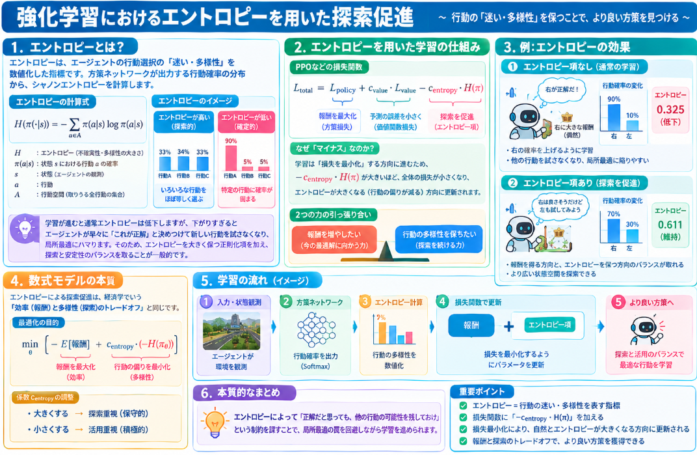

強化学習では状態空間を十分に探索することで、より良い行動方策を獲得できます。
探索を促進する仕組みには方策のエントロピを用いることで実現されるものがあります。

本日はエントロピを用いた探索促進の仕組みについて説明していきます。

## エントロピ

### 概要
強化学習におけるエントロピーとは、**エージェントの行動選択の「迷い・多様性」を数値化した指標**です。

方策ネットワークが出力する「各行動を選ぶ確率」の分布に対し、情報理論のシャノンエントロピーを計算します。

- **エントロピーが高い** → いろいろな行動をほぼ等しく選ぶ（**探索的**）
- **エントロピーが低い** → 特定の行動に確率が固まる（**確定的**）

学習が進むと通常エントロピーは低下しますが、**下がりすぎるとエージェントが早々に「これが正解」と決めつけて新しい行動を試さなくなり、局所最適にハマります**。

そのためPPOなどでは、損失関数に「エントロピーを大きく保つ」正則化項を加え、**探索と安定性のバランスを取る**のが一般的です。

### 数式
強化学習におけるエントロピー（シャノンエントロピー）の定義式は以下の通りです。

__単一状態 $s$ におけるエントロピー__

$$H\bigl(\pi(\cdot \mid s)\bigr) = -\sum_{a \in \mathcal{A}} \pi(a \mid s) \log \pi(a \mid s)$$

__学習時に用いられるミニバッチ全体の平均エントロピー__

$$\text{Entropy} = \frac{1}{N} \sum_{i=1}^{N} H\bigl(\pi(\cdot \mid s_i)\bigr) = -\frac{1}{N} \sum_{i=1}^{N} \sum_{a \in \mathcal{A}} \pi(a \mid s_i) \log \pi(a \mid s_i)$$

| 記号 | 意味 |
|---|---|
| $H$ | エントロピー（Entropy）。不確実性・多様性の大きさを表す非負の実数。 |
| $\pi(a \mid s)$ | **方策（policy）**。状態 $s$ のときに行動 $a$ を選択する確率。 |
| $s$ | エージェントが観測した**状態（state）**。 |
| $a$ | エージェントが取りうる**行動（action）**。 |
| $\mathcal{A}$ | **行動空間**。取りうる全行動の集合。 |
| $\pi(\cdot \mid s)$ | 状態 $s$ における行動確率の**分布全体**。 |
| $\log$ | 自然対数（$\ln$）。底が2ならビット、底が $e$ ならナッツ（nats）。強化学習では自然対数が一般的。 |
| $N$ | ミニバッチに含まれる**状態の数（バッチサイズ）**。 |
| $s_i$ | ミニバッチ内の $i$ 番目の状態。 |

__補足__

- $\pi(a \mid s)$ は、ニューラルネットワークの出力にSoftmaxを適用したものとして得られます。
- $\log$ の中に0が入ると $-\infty$ になってしまうため、実装では通常 $\log(\pi(a \mid s) + \epsilon)$ のように微小値 $\epsilon$（例：$10^{-10}$）を足します。

## エントロピを用いる探索促進

強化学習でエントロピーを使った探索促進は、**「得られる報酬を最大化しようとする力」と「行動をバランス良く保とうとする力」の引っ張り合い（トレードオフ）** として設計されています。

以下に、その数式モデルと直感的な仕組みを解説します。

### 1. 基本の数式モデル

PPOなどの方策勾配法では、学習の損失関数（Loss）を以下のように定義します。

$$\mathcal{L}_{\text{total}} = \mathcal{L}_{\text{policy}} + c_{\text{value}} \cdot \mathcal{L}_{\text{value}} \underbrace{- c_{\text{entropy}} \cdot H(\pi)}_{\text{探索促進項}}$$

__記号の意味__

| 記号 | 意味 |
|---|---|
| $\mathcal{L}_{\text{total}}$ | **全体の損失関数**。これを最小化するようにニューラルネットの重みを更新する。 |
| $\mathcal{L}_{\text{policy}}$ | **方策損失**（例：PPOのClipped Surrogate Objective）。報酬を多く得る行動を強化する項。 |
| $\mathcal{L}_{\text{value}}$ | **価値関数損失**。状態価値の予測誤差（MSEなど）。 |
| $c_{\text{value}}, c_{\text{entropy}}$ | **係数（ハイパーパラメータ）**。各項の強さを調整する重み。 |
| $H(\pi)$ | **方策のエントロピー**。行動の多様性を表す指標。 |

### 2. なぜ「マイナス」なのか？

ニューラルネットの学習は**損失を最小化する**方向に進みます。

- $\mathcal{L}_{\text{policy}}$ は小さくしたい（報酬を増やしたい）
- $- c_{\text{entropy}} \cdot H(\pi)$ は、$H(\pi)$ が**大きいほど全体の損失が小さくなる**

つまり、**損失を最小化しようとする最適化アルゴリズムは、自然と「エントロピーを大きくする（行動を均等化する）」方向にも重みを更新してしまう**のです。

これが「探索を促す」という仕組みの核心です。

### 3. 直感的なメカニズム（2つの力の引っ張り合い）

エージェントの行動確率が「右・左」の2つだけだと想像してください。

__学習初期（エントロピーが高い）__
- 右：50%、左：50%
- $H = -(0.5\log 0.5 + 0.5\log 0.5) = 0.693$（比較的大きい）

__通常の学習（エントロピー項なし）__
「右」を選んだら偶然大きな報酬が得られたとします。
- $\mathcal{L}_{\text{policy}}$ が「右の確率を上げろ」と勾配を流す
- 右：90%、左：10% になる
- $H = -(0.9\log 0.9 + 0.1\log 0.1) \approx 0.325$（急激に低下）

→ **「右が正解だ！」と早々に決めつけてしまい、左を試さなくなる（局所最適）**

__エントロピー項ありの学習__
- $\mathcal{L}_{\text{policy}}$ が「右を上げろ」と言う
- **$-c_{\text{entropy}} \cdot H$ が「確率を均等に保て（$H$ を大きくしろ）」と言う**
- 結果として、右：70%、左：30% くらいで**釣り合う**

→ **「右は良さそうだけど、左もたまに試してみよう」という状態が維持される**

### 4. 数式モデルの本質

このモデルは経済学でいう **「効率（報酬）と多様性（探索）のトレードオフ」** そのものです。

$$\min_{\theta} \Bigl[ \underbrace{-\mathbb{E}[\text{報酬}]}_{\text{報酬を最大化}} + \underbrace{c_{\text{entropy}} \cdot (-H(\pi_\theta))}_{\text{行動の偏りを最小化}} \Bigr]$$

- 第1項だけだと、**今見えている最適解に全力投球**してしまう
- 第2項が「**他の選択肢も生かしておけ**」とブレーキをかける

このブレーキの強さが $c_{\text{entropy}}$ で制御されます。
- $c_{\text{entropy}}$ を大きくする → 探索重視（保守的）
- $c_{\text{entropy}}$ を小さくする → 活用重視（積極的）

## まとめ

エントロピーによる探索促進は、**損失関数の中に「行動の偏り」を罰する項を設けることで、エージェントに「正解だと思っても、他の行動の可能性を残しておけ」という制約を課す**数式モデルです。

情報理論の「不確実性の平均」という概念を、**「探索の意思」として方策に埋め込む**ことで、局所最適の罠を回避しながら学習を進められるように設計されています。

