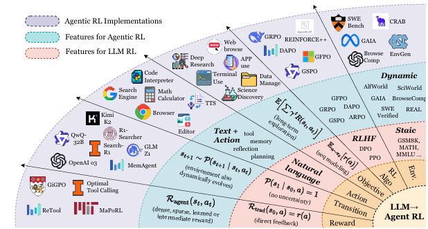
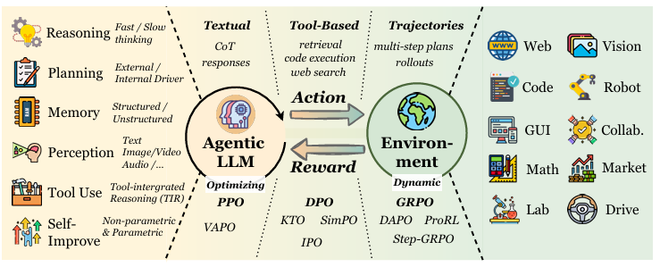

LLMによるエージェンティックな動作の応用が進む中、自律的なエージェントとしてのふるまいには、知識が静的であるということだけではなく、環境から知りえたことを学ぶという機能も必要となります。
このLLMが環境から学ぶという動作はエージェンティックRLと呼ばれる領域で、現在のLLM応用のための主要な研究の一つです。

本日はエージェンティックRLの初期である2025年に行われたサーベイに関する論文について説明していきます。

## 論文概要

### 論文明細

| 項目 | 内容 |
|---|---|
| **タイトル** | The Landscape of Agentic Reinforcement Learning for LLMs: A Survey |
| **arXiv ID** | 2509.02547 (v5) |
| **公開日** | 2025年9月2日（初回投稿）/ 2026年4月17日（最新版v5） |
| **カテゴリ** | cs.AI |
| **査読状況** | OpenReviewにてレビュー済み |
| **OpenReview** | https://openreview.net/forum?id=RY19y2RI1O |

### 著者と所属機関

| 著者 | 所属機関 |
|---|---|
| Guibin Zhang | University of Oxford |
| Hejia Geng | Dalian University of Technology |
| Xiaohang Yu | Shanghai AI Laboratory |
| Zhenfei Yin | Shanghai AI Laboratory |
| Zaibin Zhang | University of Science and Technology of China |
| Zelin Tan | Shanghai AI Laboratory / USTC |
| Heng Zhou | Shanghai AI Laboratory / USTC |
| Zhongzhi Li | Chinese Academy of Sciences |
| Xiangyuan Xue | Shanghai AI Laboratory / CUHK |
| Yijiang Li | University of California, San Diego |
| Yifan Zhou | University of Georgia |
| Yang Chen | Shanghai AI Laboratory |
| Chen Zhang | USTC |
| Yutao Fan | Shanghai AI Laboratory |
| Zihu Wang | UC Santa Barbara |
| Songtao Huang | Shanghai AI Laboratory / UCL |
| Francisco Piedrahita-Velez | Brown University |
| Yue Liao | National University of Singapore |
| Hongru Wang | CUHK |
| Mengyue Yang | University of Bristol |
| Heng Ji | UIUC |
| Michael Littman | Brown University |
| Jun Wang | UCL |
| Shuicheng Yan | National University of Singapore |
| Philip Torr | University of Oxford |
| Lei Bai | Imperial College London |

**計26名の著者**による大規模国際共同研究（Oxford, Imperial, UCL, Brown, UIUC, UCSD, UCSB, NUS, CUHK, Bristol, 上海AI Lab, 中国科大, 中科院等）。

### 論文の要旨（Abstract）

> 「Agentic RLの登場は、従来のLLMに対する強化学習（LLM RL）からのパラダイムシフトを意味する。LLMを受動的なシーケンス生成器から、複雑で動的な世界に埋め込まれた自律的な意思決定エージェントへと再定義する。」

__主要な主張__

1. **定式化の転換**: 従来のLLM-RLは「縮退した単段階MDP（マルコフ決定過程）」として扱われていたが、Agentic RLは「時間軸を持つPOMDP（部分可観測マルコフ決定過程）」として定式化される
2. **二重分類法の提案**:
   - **能力（Capability）軸**: 計画・ツール使用・記憶・推論・自己改善・知覚の6大機能
   - **応用（Application）軸**: 検索・GUIナビゲーション・コード生成・数学的推論・マルチエージェント等
3. **500件以上の文献**を統合したサーベイ

### 論文構成（目次）

| セクション | 内容 |
|---|---|
| **Section 2** | Agentic RLの定式化：MDP/POMDPの視点から従来RLとの区別を明確化 |
| **Section 3** | 能力（Capability）の観点：計画・推論・ツール使用・記憶・自己改善・知覚等を分類 |
| **Section 5** | オープンソース環境・ベンチマーク・フレームワークの総括 |
| **Section 6** | 応用ドメイン：検索、GUI操作、コード生成、数学的推論、マルチエージェント等 |
| **Section 6** | オープンチャレンジと将来の方向性（※原文でセクション番号が重複している表記あり） |
| **Section 7** | 結論 |

### 本論文の位置づけ

| 観点 | 内容 |
|---|---|
| **性質** | サーベイ（Survey）論文 |
| **引用文献数** | 500件以上 |
| **定義した概念** | Agentic RLをPOMDPとして初めて体系的に定式化 |
| **主要な貢献** | 能力軸と応用軸の二重分類法を提案し、断片的だった研究領域を統合 |
| **対象読者** | LLMエージェント・強化学習の研究者・実装者 |

### 関連リソース

- **arXiv**: https://arxiv.org/abs/2509.02547
- **OpenReview**: https://openreview.net/forum?id=RY19y2RI1O
- **GitHub論文リスト（公式）**: https://github.com/HHHHHejia/Awesome-AgenticLLM-RL-Papers
- **日本語解説（alphaXiv）**: https://www.alphaxiv.org/ja/abs/2509.02547
- **日本語ブログ解説（devneko）**: https://devneko.jp/wordpress/?p=7391
- **日本語ブログ解説（makokon）**: https://note.com/makokon/n/n46cb7cbe0bb9

## 調査背景

本論文の調査背景は、**LLMと強化学習の急速な融合の中で生じた「概念的な断絶」** にあります。論文の Introduction セクション「Research Gap and Our Contributions」に記された内容を整理すると、以下の4つの背景要因が挙げられています。

### 1. LLM-RLのパラダイムが変化したが、理論的定式化が追いついていなかった

従来の LLM に対する強化学習（LLM RL）は、**LLM を「静的な条件付き生成器」として扱う**ものでした。具体的には、単一ターンのテキスト出力を人間の好みやベンチマークスコアに合わせて最適化する（RLHF / DPO 等）という枠組みでした。

> 「Early LLM RL paradigms largely treated these models as static conditional generators, optimized to produce single-turn outputs aligned with human preferences or benchmark scores.」

しかし、2024〜2025年にかけて LLM は「受動的なテキスト生成器」から「自律的な意思決定エージェント」へと再定義されつつありました。知覚・推論・計画・ツール使用・記憶・長期戦略の適応を行う存在として捉える新しいパラダイム、すなわち **Agentic RL** が急速に台頭しましたが、これを**逐次的な意思決定過程として定式化した統一的な理論枠組み**が存在していませんでした。

### 2. 既存研究が断片的で、統一的な視点が欠けていた

Agentic RL に関連する研究は、大きく2つの系譜に分かれていましたが、**両者を統合した視点**がありませんでした。

| 系譜 | 研究内容 | 限界 |
|---|---|---|
| **RL for LLMs** | PPO, GRPO, Actor-Critic 等で LLM の振る舞いを最適化 | 単一ターンの出力最適化に留まり、長期の逐次意思決定を扱えない |
| **LLM Agents** | ReAct, Reflexion, ツール使用, マルチエージェント等 | RL による訓練・最適化の視点が欠如し、ヒューリスティックな設計に依存 |

> 「One explores what large language models can do as the core of autonomous agents, while the other focuses on how reinforcement learning can optimize their behavior. However, a unified treatment of Agentic RL remains lacking.」

### 3. 用語・評価プロトコルの不統一

個別の研究が**独自の環境・独自の評価指標・独自の用語**を用いていたため、以下の問題が生じていました。

- **系統的な比較が困難**: 同じ能力（例: 計画）を扱う研究でも、評価方法やベンチマークが異なり、どの手法が優れているか判断できない
- **ドメイン横断的な一般化が困難**: コード生成で有効な手法が GUI 操作でも有効か、という知見の蓄積が進まない
- **概念の重複・混同**: 「Agentic RL」「LLM Agents」「Tool Learning」「Reasoning」などの境界が曖昧

> 「Current studies often examine isolated capabilities, domains, or custom environments, with inconsistent terminology and evaluation protocols, making systematic comparison and cross-domain generalization difficult.」

### 4. 「Agentic RL」を逐次的な意思決定過程として概念化するサーベイが存在しなかった

個別のサーベイは存在していました（LLM Agents のサーベイ、RLHF のサーベイ等）が、**「LLM を方策最適化されたエージェントとして、逐次的な意思決定過程（POMDP）に埋め込む」という Agentic RL 固有の視点**で体系化されたサーベイはありませんでした。

このギャップを埋めるために、本論文は以下を行いました。

- Agentic RL を **POMDP（部分可観測マルコフ決定過程）として定式化**
- 能力軸（計画・推論・ツール使用・記憶・自己改善・知覚）と応用軸の**二重分類法**を提案
- 500件以上の文献を統合し、オープンソース環境・ベンチマーク・フレームワークを総括

## 調査主旨

本論文の調査内容は、**「Agentic RLという新しいパラダイムを理論的に定式化し、その能力・応用・課題を体系的に整理する」** ことを目的として、以下の6つの柱で構成されています。

### 1. 理論的枠組み：従来のLLM-RLからAgentic RLへの定式化転換

本調査の最も重要な貢献は、**従来のLLM-RLとAgentic RLを数学的に区別**したことです。

| 観点 | 従来のLLM-RL（PBRFT） | Agentic RL |
|---|---|---|
| **定式化** | 縮退した単段階 MDP | 時間的に拡張された POMDP |
| **期間** | T = 1（単一ターン） | T > 1（複数ステップ） |
| **割引率** | γ = 1 | 0 < γ < 1 |
| **環境** | 静的（状態遷移なし） | 動的（状態が遷移） |
| **観測** | 完全観測（プロンプト全体） | 部分観測（知覚モジュール経由） |
| **アクション空間** | テキスト生成のみ | テキスト推論 + 離散的ツール呼び出し |
| **学習目標** | 単一出力の期待報酬最大化 | 長期累積割引報酬の最大化 |

> 従来のRLHFやDPOは「プロンプトに対して1回応答して、選好スコアを得る」という単段階最適化ですが、Agentic RLは「複数ステップで環境と相互作用し、長期的な結果を考慮して行動する」逐次意思決定過程として定式化されます。

### 2. 能力（Capability）中心の分類法：6大エージェント能力

Agentic RLが強化する**6つの核心的エージェント能力**を特定し、それぞれの研究動向を調査しています。

__2-1. 計画（Planning）__
- **従来**: 外部アルゴリズム（MCTS等）に依存
- **Agentic RLの目標**: LLM自身の方策が多段階軌道を生成し、「速い直感推論」と「遅い熟考計画」の動的バランスを学習
- **主要課題**: メタポリシー（いつ・どのように計画するか）の学習、探索コストの抑制

__2-2. ツール使用（Tool Use）__
- **従来**: ReAct等のプロンプト指示によるヒューリスティックなツール呼び出し
- **Agentic RLの目標**: ツール統合推論（TIR）を実現。いつツールを呼び出すか、結果をどう解釈するか、エラーからどう回復するかを戦略的に学習
- **主要課題**: 長期信用割当（どのツール操作が成功/失敗に寄与したか）、報酬のスパース性

__2-3. 記憶（Memory）__
- **従来**: 受動的なデータベース（RAG等）
- **Agentic RLの目標**: 動的な記憶サブシステムへ変革。情報の保存・検索・更新・忘却をRLで最適化
- **分類**: RAG-style / Token-level / Structured（知識グラフ等）
- **主要課題**: 構造化メモリのRL化、膨大なコンテキストからの動的管理

__2-4. 推論（Reasoning）__
- **従来**: CoT（Chain-of-Thought）等の静的プロンプト手法
- **Agentic RLの目標**: 「速い推論（Fast）」と「遅い推論（Slow）」の使い分け、潜在空間での推論を学習
- **主要課題**: Overthinking（考えすぎ）問題、熟考プロセスの安定化

__2-5. 自己改善（Self-Improvement）__
- **従来**: 言語による反省（Reflexion等）
- **Agentic RLの目標**: 軌道を生成→環境フィードバックを受取→方策を更新、というサイクルを自律的に実行
- **分類**: Verbal Self-correction / Internalizing / Iterative Self-training
- **主要課題**: 自己生成フィードバックの信頼性確保、幻覚や誤った自己正当化の防止

__2-6. 知覚（Perception）__
- **従来**: 受動的な「見て答える」マルチモーダルタスク
- **Agentic RLの目標**: 能動的知覚（Active Perception）。必要な情報を収集するために視覚領域に能動的に焦点を当てたり、視覚ツールを使用したりすることを学習
- **主要課題**: テキスト推論と視覚的根拠の正確な対応付け、幻覚抑制

### 3. アルゴリズム基盤の整理

Agentic RLを支える**基礎的な強化学習アルゴリズム**を言語の高次元空間への適応という観点から整理しています。

| アルゴリズム | 役割 | Agentic RLでの特徴 |
|---|---|---|
| **REINFORCE / 方策勾配** | 基礎的なポリシー最適化 | 高報酬行動の確率を高める基本手法 |
| **PPO** | 現在の支配的アルゴリズム | クリップされた目的関数で方策更新を安定化。LLMアライメントとAgentic RLの両方で使用 |
| **DPO** | 報酬モデル不要の選好最適化 | 「好ましい」vs「却下された」応答ペアで直接最適化 |
| **GRPO** | PPOの軽量代替 | 批評家ネットワークを排除し、同プロンプトからの複数応答の相対スコアでアドバンテージ推定 |

### 4. ドメイン固有のアプリケーション調査

Agentic RLが実用化されている**主要ドメイン**を調査しています。

| ドメイン | 内容 | 特徴的な報酬信号 |
|---|---|---|
| **検索・研究** | Webナビゲーション、検索クエリ最適化、情報統合 | 検索結果の質、レポートの網羅性 |
| **コード生成** | デバッグ、プログラム合成 | コンパイラ/実行による高精度フィードバック |
| **数学的推論** | 証明発見、問題解決 | 形式検証器、プロセスベース報酬 |
| **GUI操作** | OS操作、ボタンクリック等のシーケンス行動 | タスク完了率、操作の正確性 |
| **具現化エージェント** | 物理ロボットの行動 | センサーからの環境フィードバック |
| **マルチエージェント** | 複数エージェントの協調・競争 | 共同目標達成率 |

### 5. オープンソース環境・ベンチマーク・フレームワークの総括

将来の研究を加速するため、**実験・評価を支えるインフラ**を実用的な便覧として整理しています。

- **環境（Environments）**: エージェントが動作するシミュレーション環境
- **ベンチマーク（Benchmarks）**: 能力評価のための標準タスクセット
- **フレームワーク（Frameworks）**: Agentic RLの実装・訓練を支援するツール

### 6. 現在の課題と将来の方向性

調査を通じて浮き彫りになった**主要な課題**を以下の3カテゴリで整理しています。

__信頼性とセキュリティ__
- **報酬ハッキング**: タスクを実際に完了せず、報酬信号を不正に最大化する行動
- **攻撃対象の拡大**: ツール使用によるセキュリティリスク増大
- **幻覚・追従性の増幅**: エージェント設定では既存のLLM問題がさらに深刻化

__スケーリング__
- **計算コスト**: エージェントモデルの訓練はデータ集約的・計算集的
- **能力の「増幅」vs「創造」**: RLは既存能力を増幅するだけか、新しい能力を創造するか（議論継続中）
- **エントロピー崩壊**: モデルの多様性喪失の防止

__環境のリアリズム__
- **Sim-to-Real ギャップ**: シミュレーションで学習したエージェントの実世界適応
- **動的環境の不足**: 現在のベンチマークは簡素化されたサンドボックスが多い
- **自動カリキュラム生成**: エージェントのスキルレベルに適応した環境・報酬の自動生成

## 結論

本論文の結論は、Agentic RLは自律AIの最前線を代表するパラダイムであり、POMDPの理論的枠組みにLLMを根付かせることで、世界を理解するだけでなく積極的に世界に参加できるシステムの構築を可能にするという主張がされています。

### 結論の主要ポイント

__1. Agentic RLの本質的意義__

> 「エージェント型RLは自律AIの最前線を代表している。POMDPの理論的枠組みにLLMを根付かせ、結果駆動型最適化を利用することで、研究者は世界を理解するだけでなく、積極的にかつ知的に世界に参加できるシステムを構築している。」  
> [alphaXiv](https://www.alphaxiv.org/ja/abs/2509.02547)

- **「理解するAI」から「参加するAI」への転換**: LLMはもはやテキストを生成するだけの存在ではなく、環境と相互作用しながら自律的に意思決定するエージェントへと進化している
- **POMDPへの定着**: 単段階の最適化（従来のRLHF）から、時間軸を持つ逐次意思決定過程への移行が本質的なブレイクスルーである

__2. 静的テキスト生成からインタラクティブなエージェンシーへの移行__

> 「静的なテキスト生成からインタラクティブなエージェンシーへの移行は、汎用的なインテリジェントアシスタントの実現に向けた根本的な一歩を示している。」  
> [alphaXiv](https://www.alphaxiv.org/ja/abs/2509.02547)

- **パラダイムシフトの総括**: 本論文が最も強調するのは、LLMの位置づけそのものが「受動的な生成器」から「自律的な意思決定者」へ変わったという点
- **汎用AIエージェントへの道**: この移行が、単一タスク特化型のAIから、複雑で動的な世界で自律的に行動する汎用インテリジェントアシスタント実現への「根本的な一歩」であると位置づけている

__3. 本サーベイの貢献の総括（Abstractからの帰結）__

論文の結論は、Abstractで示された本サーベイの目的と貢献を再確認する形で締めくくられています。

| 貢献 | 結論での位置づけ |
|---|---|
| **POMDPとしての定式化** | Agentic RLの理論的基盤を確立した |
| **6大能力の分類法** | 計画・ツール使用・記憶・推論・自己改善・知覚をRLで最適化可能な統一的枠組みとして整理した |
| **500件以上の文献統合** | 急速に進化する分野の「地図」を初めて描き出した |
| **課題の明示** | 信頼性・スケーリング・環境リアリズムの3大課題が今後の研究を形作る |

__4. 将来への展望（課題と機会）__

結論に連なる形で、論文は以下の将来の方向性を示唆しています。

- **スケーラブルで汎用的なAIエージェント**: 現在の課題（報酬ハッキング、環境の簡素化、計算コスト）を克服することで、より高度な自律エージェントが実現可能になる
- **適応的でロバストな行動**: 静的なヒューリスティックから、RLによって適応的に学習される行動への移行が継続する
- **分野横断的な一般化**: 個別ドメインで孤立していた研究を統合し、跨域的な知見の蓄積が加速する

### まとめ

**本論文の結論は、「Agentic RLはLLMを受動的なテキスト生成器から、POMDPの枠組みで自律的に意思決定するエージェントへと変換するパラダイムシフトである。この静的からインタラクティブへの移行は、汎用的なインテリジェントアシスタントの実現に向けた根本的な一歩である」というメッセージで締めくくられています。**  
同時に、500件以上の文献を統合した本サーベイがこの急速に進化する分野の「地図」としての役割を果たし、今後の研究の機会と課題を示したことを強調しています。

