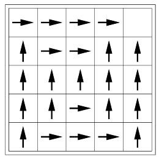
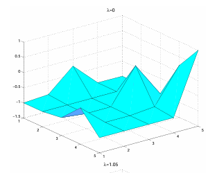
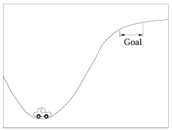

強化学習は問題を解かせる際に設定した報酬によって最適な方策を見つけ出すという学習法です。
報酬によって、強化学習エージェントの動作は影響を受けます。

ではこの報酬はどう決めるのでしょうか。
基本は人が決めますが、そうではなく、報酬もあるべき姿をアルゴリズム的に求解することが出来るのではと考えた逆強化学習という研究分野があります。

本日はそんな逆強化学習の先駆けとなった研究論文について説明していきます。

## 概要

以下に、Andrew Y. Ng と Stuart J. Russell による論文「Algorithms for Inverse Reinforcement Learning」の概要をまとめます。

### 論文情報

- **タイトル**: Algorithms for Inverse Reinforcement Learning
- **著者**: Andrew Y. Ng, Stuart J. Russell
- **発表年**: 2000年
- **学会**: ICML (International Conference on Machine Learning) 2000
- **ページ**: 663–670

### 主旨の概要

本論文は、**マルコフ決定過程（MDP）において、観測された最適行動（方策）から報酬関数を推定する問題**を初めて形式的に定式化し、解法を提示した画期的な研究です。

__背景と動機__

強化学習では通常、報酬関数が既知であることを前提に最適方策を学習します。しかし、実世界では報酬関数を人間が設計することが困難な場合が多くあります（例：運転技術、動物の行動）。そこで著者らは、**専門家の行動を観測することで、その行動を説明する報酬関数を逆算する**という「逆強化学習（Inverse Reinforcement Learning, IRL）」の問題を提起しました。動機として、(a) 見習い学習（apprenticeship learning）による熟練行動の獲得、および (b) 自然系（動物や人間）が最適化している報酬関数の特定が挙げられています。[ICML 2000 Proceedings](https://dl.acm.org/doi/10.5555/645529.657801)

__縮退性（Degeneracy）の問題__

本論文の重要な貢献の一つは、IRLにおける**縮退性（degeneracy）** の問題を明らかにした点です。与えられた観測方策が最適となる報酬関数は、一般に**無数に存在**します。例えば、すべての状態で一定値を返す報酬関数は、どの方策に対しても最適であるため、観測された方策を「説明」してしまいます。これでは報酬関数を一意に推定できません。[Berkeley CS](https://people.eecs.berkeley.edu/%7erussell/papers/ml00-irl.pdf)

__解決策：方策の区別性を最大化する報酬関数__

縮退性を解消するため、著者らは **「観測された方策と、他のすべての劣最適方策を最大限に区別できる報酬関数」** を選ぶという方針を提案しました。具体的には、観測方策の価値と、次善のアクションの価値との差を最大化するような報酬関数を、**線形計画法（Linear Programming）** として定式化しています。これにより、計算効率よく報酬関数を推定できるようになりました。[Berkeley CS](https://people.eecs.berkeley.edu/%7erussell/papers/ml00-irl.pdf)

__提案された3つのアルゴリズム__

本論文では、設定に応じて以下の3つのアルゴリズムを導出しています。

1. **有限状態空間（テーブル形式）**: 状態数が有限で、報酬関数を各状態に対するテーブルとして表現する場合。線形計画法で効率的に解けることを示しました。
2. **線形関数近似**: 状態空間が大規模・無限の場合に、報酬関数を状態特徴量の線形結合として近似する場合。こちらも線形計画法で扱えます。
3. **軌道のみが観測可能な場合**: 完全な方策ではなく、専門家の行動軌道（trajectory）のサンプル集合のみが与えられる、より現実的な設定。期待累積報酬の推定から報酬関数を復元します。[Berkeley CS](https://people.eecs.berkeley.edu/%7erussell/papers/ml00-irl.pdf)

### 本論文の意義

本論文は、逆強化学習という分野を学術的に確立した**決定的な源流論文**です。「報酬関数を学習する」という逆問題を数学的に定式化し、縮退性という本質的な難題を明らかにした上で、実用的な線形計画法による解法を提示しました。この枠組みは、後の**見習い学習（Abbeel & Ng, 2004）**や**逆最適制御との統合**、さらには近年の**報酬モデリング（Reward Modeling）**や**RLHF（Reinforcement Learning from Human Feedback）**の理論的基盤としても広く引用されています。[ICML 2000 Proceedings](https://dl.acm.org/doi/10.5555/645529.657801)

## 解決しようとした課題

本論文が解決しようとした課題は、一言で言えば **「人間が報酬関数を設計しなくても、専門家の行動から報酬の『意図』を自動で読み取る」** ことです。以下、3つの観点からわかりやすく説明します。

### 課題1：報酬関数を人間が設計するのは非常に難しい

通常の強化学習では、「良い行動をとればプラスの報酬、悪い行動をとればマイナスの報酬」というルールを**人間が最初から設計**する必要があります。しかし、現実の複雑なタスクではこれが極めて困難です。

たとえば**自動車の運転**を考えてみてください。安全に目的地に到達するための報酬関数を、人間がゼロから設計しようとすると、「速度を上げすぎない」「車間距離を保つ」「歩行者を優先する」「急ブレーキを避ける」「燃費を考慮する」など、無数の要素を数式で表現し、それらの重みを調整しなければなりません。設計者の意図と異なる危険な運転を奖励してしまうリスクも常につきまといます。

Ng & Russellは、この **「報酬設計の手間と不正確さ」** を根本的に回避するために、逆強化学習という枠組みを提案しました。熟練ドライバーの運転データを観測すれば、その行動を最適だと思わせる「暗黙の報酬関数」を自動的に推定できるはずだ、という発想です。[Berkeley CS](https://people.eecs.berkeley.edu/%7erussell/papers/ml00-irl.pdf)

### 課題2：「縮退性（Degeneracy）」という逆問題の罠

報酬関数を行動から逆算しようとすると、すぐに **「縮退性（degeneracy）」** という深刻な問題に直面します。これは本論文で初めて形式的に指摘された、逆強化学習の核心的な課題です。

具体例で説明します。あるロボットが「部屋のゴミを拾ってゴミ箱に入れる」行動を繰り返しているとします。この行動を説明する報酬関数として、以下のような無数の候補が考えられます。

- **A**: 「ゴミを拾うと＋10、ゴミ箱に入れると＋100」
- **B**: 「部屋にいるだけで＋1（何もしなくても報酬がもらえる）」
- **C**: 「壁にぶつかると−5、それ以外は0」

実は、**BやCの報酬関数でも、そのロボットの行動は「最適」であると説明できてしまう**のです。なぜなら、「最適な行動」という条件だけでは報酬関数を一意に決定できないからです。すべての状態で同じ値を与えるような自明な報酬関数でも、どんな行動も等しく最適になってしまいます。

つまり、**「行動の観測データ」から「報酬関数」を推定する問題は、数学的には不定問題（解が無数に存在する）** なのです。これが縮退性です。[Berkeley CS](https://people.eecs.berkeley.edu/%7erussell/papers/ml00-irl.pdf)

### 課題3：縮退性の中から「意味のある報酬関数」を選ぶ

縮退性のために、単純に「観測された行動が最適になる報酬関数を探す」だけでは、自明で無意味な報酬関数（例：すべての行動に同じ報酬を与える関数）が返されてしまいます。そこで本論文が解決を目指したのは、**「縮退性の中から、専門家の行動の『意図』を最もよく表している報酬関数を選び出す」** 方法でした。

Ng & Russellが採用した方針は、以下の直感に基づいています。

> **「専門家が選んだ行動は、他に考えられる行動よりも明らかに優れているはずだ」**

つまり、専門家の行動の価値と、**「専門家が選ばなかった次善のアクション」の価値との差をできるだけ大きくする**ような報酬関数を選ぶのです。この差が大きいほど、「専門家はこの行動を他の行動より明確に選好している」と解釈できます。

たとえば、運転の例で言えば、「赤信号で止まる」という専門家の行動に対して、「信号を無視して進む」という代替行動との価値差を最大化する報酬関数を選ぶことで、「安全を重視する」という意図が抽出されるわけです。

この方針を**線形計画法（Linear Programming）** として定式化することで、計算効率よく意味のある報酬関数を推定できる手法を本論文は初めて示しました。[Berkeley CS](https://people.eecs.berkeley.edu/%7erussell/papers/ml00-irl.pdf)

## 提案内容

本論文が提案した内容を説明します。

### 1. 問題の定式化：MDPにおけるIRL

本論文では、標準的な**マルコフ決定過程（MDP）** を前提とします。MDPは以下の要素で定義されます。

$$
M = (S, A, T, \gamma, R)
$$

- $S$: 状態（state）の集合
- $A$: 行動（action）の集合
- $T(s' | s, a)$: 状態遷移確率（$s$で$a$を取ると$s'$に遷移する確率）
- $\gamma \in [0,1)$ : 割引率（将来の報酬をどれだけ重視するか）
- $R(s)$: 報酬関数（状態$s$にいるときに得られる報酬）

通常の強化学習では、$R$ が与えられていて、**最適方策** $\pi^*$ を求めます。逆強化学習（IRL）ではその逆で、**最適方策 $\pi^*$（またはその観測軌道）が与えられていて、$R$を推定する**問題です。

### 2. 縮退性の問題：なぜIRLは難しいか

まず、以下の**ベルマン方程式**を思い出します。方策 $\pi$ の価値関数 $V^\pi(s)$ は以下を満たします。

$$V^\pi(s) = R(s) + \gamma \sum_{s'} T(s' | s, \pi(s)) V^\pi(s')$$

最適方策 $\pi^*$ は、すべての状態 $s$ で、他の行動 $a$ よりも価値が高くなるように選ばれます。

$$Q^{\pi^*}(s, \pi^*(s)) \geq Q^{\pi^*}(s, a) \quad \forall a \in A$$

ここで問題なのは、**この条件を満たす報酬関数 $R$ は無数に存在する**ということです。例えば、すべての状態で同じ定数 $c$ を返す報酬関数 $R(s) = c$ を考えると、どの行動を選んでも価値は同じになるため、**どんな方策も「最適」になってしまいます**。

つまり、$\pi^*$ から $R$ を一意に復元することはできません。これが**縮退性（degeneracy）** です。

### 3. 解決策：専門家行動と劣行動の価値差を最大化

Ng & Russellは、縮退性を解消するために以下の直感に基づく方針を提案しました。

> **「専門家が選んだ行動は、他の行動より明らかに優れているはずだ」**

つまり、専門家の行動 $\pi^*(s)$ の価値と、**次善のアクション** $a$ の価値との差を最大化するような報酬関数を選ぶのです。

$$\max_R \sum_{s \in S} \left[ Q^{\pi^*}(s, \pi^*(s)) - \max_{a \neq \pi^*(s)} Q^{\pi^*}(s, a) \right]$$

この差が大きいほど、「専門家はこの行動を他の行動より明確に選好している」と解釈できます。これにより、自明な報酬関数（例：$R(s) = c$）を排除できます。

### 4. 線形計画法による定式化

報酬関数を**状態特徴量の線形結合**として表現します。

$$R(s) = \mathbf{w}^\top \phi(s) = \sum_{i=1}^d w_i \phi_i(s)$$

ここで、$\phi(s) = [\phi_1(s), \dots, \phi_d(s)]^\top$ は状態 $s$ の特徴量ベクトル、$\mathbf{w}$ は重みベクトルです。

価値関数も線形になります。

$$V^\pi(s) = \mathbf{w}^\top \psi^\pi(s)$$

$\psi^\pi(s)$ は方策 $\pi$ における期待累積特徴量です。

$$\psi^\pi(s) = \mathbb{E}\left[ \sum_{t=0}^\infty \gamma^t \phi(s_t) \mid s_0 = s, \pi \right]$$

これを用いると、専門家行動と他の行動 $a$ の価値差は以下のように書けます。

$$Q^{\pi^*}(s, \pi^*(s)) - Q^{\pi^*}(s, a) = \mathbf{w}^\top \left[ \psi^{\pi^*}(s, \pi^*(s)) - \psi^{\pi^*}(s, a) \right]$$

ここで、$\psi^{\pi^*}(s, a)$ は状態 $s$ で行動 $a$ を取った後に $\pi^*$ に従うときの期待累積特徴量です。

Ng & Russellは、以下の**線形計画法（Linear Programming）** を提案しました。

$$\max_{\mathbf{w}, \delta} \sum_{s \in S} \delta_s$$

subject to:

$$\mathbf{w}^\top \left[ \psi^{\pi^*}(s, \pi^*(s)) - \psi^{\pi^*}(s, a) \right] \geq \delta_s \quad \forall s, \forall a \neq \pi^*(s)$$

$$\|\mathbf{w}\|_1 \leq 1 \quad \text{(正則化)}$$

$$\delta_s \geq 0 \quad \forall s$$

- $\delta_s$ は状態 $s$ での専門家行動と次善行動の価値差の下限です。
- 目的関数は、この差の和を最大化します。
- $\|\mathbf{w}\|_1 \leq 1$ は正則化項で、報酬関数のスケールを制限します（報酬の絶対値を無限大にして差を大きくするのを防ぐ）。

これにより、**「専門家の行動を最もよく他の行動と区別できる」報酬関数の重み $\mathbf{w}$** が効率的に求まります。

### 5. 3つのアルゴリズム

本論文では、設定に応じて以下の3つのアルゴリズムを導出しています。

__アルゴリズム1：有限状態空間（テーブル形式）__

- 状態数 $|S|$ が有限で、報酬関数を各状態に対するテーブル $R(s)$ として表現
- 上記の線形計画法を直接適用
- $\psi^{\pi^*}(s, a)$ を動的計画法で計算

__アルゴリズム2：線形関数近似__

- 状態空間が大規模・無限の場合
- $R(s) = \mathbf{w}^\top \phi(s)$ と線形近似
- 同様の線形計画法で $\mathbf{w}$ を推定

__アルゴリズム3：軌道のみが観測可能な場合__

- 完全な方策 $\pi^*$ ではなく、専門家の軌道（trajectory）のサンプル $\{(s_t, a_t)\}_{t=0}^T$ のみが与えられる
- 期待累積特徴量 $\psi^{\pi^*}(s, a)$ をモンテカルロ法で推定
- 推定値を用いて線形計画法を解く

## 実験

本論文では**実験が行われています**。以下に、実験の問題設定と結果をまとめます。

### 実験の概要

本論文の第6節（Section 6）において、提案した3つのアルゴリズムを以下の3種類の問題に適用し、検証を行っています。[Berkeley CS](https://people.eecs.berkeley.edu/%7erussell/papers/ml00-irl.pdf)

### 実験の問題設定

__1. 離散・有限状態の確率的ナビゲーション問題__

- **設定**: 状態空間と行動空間が有限で、状態遷移に確率性を含むグリッドワールド型のナビゲーションタスク
- **適用アルゴリズム**: アルゴリズム1（有限状態空間、テーブル形式の報酬関数）
- **目的**: 最適方策が与えられたときに、線形計画法で報酬関数を正しく復元できるかを確認

__2. 連続・無限状態の確率的ナビゲーション問題__

- **設定**: 状態空間が連続的かつ無限のナビゲーション問題
- **適用アルゴリズム**: アルゴリズム2（線形関数近似による報酬関数）
- **目的**: 大規模・無限状態空間においても、特徴量の線形結合として報酬関数を推定できるかを確認

__3. Mountain Car 問題__

- **設定**: 強化学習の古典的ベンチマークである「Mountain Car」
  - 車が坂道を利用して重力に逆らって山を登る問題
  - 連続状態空間（位置と速度）を持つ
- **適用アルゴリズム**: アルゴリズム3（軌道のみが観測可能な場合）を含む
- **目的**: 実際には完全な最適方策ではなく、専門家の行動軌道（trajectory）のサンプルだけが与えられる、より現実的な設定でも報酬関数を復元できるかを確認

### 実験の結果

論文の記述によると、すべての実験ケースにおいて以下の結果が得られました。

> **「すべてのケースで、観測された行動を『かなり良く説明する』報酬関数を復元することができた」**
> （In all cases, we are able to recover a reward function that "explains" the observed behavior fairly well.）[Berkeley CS](https://people.eecs.berkeley.edu/%7erussell/papers/ml00-irl.pdf)

具体的には：

| 実験 | 結果の要点 |
|------|-----------|
| 離散ナビゲーション | 線形計画法により、観測された最適方策を他の劣最適方策と明確に区別する報酬関数が復元された |
| 連続ナビゲーション | 線形関数近似を用いても、縮退性を回避しながら意味のある報酬関数が推定できた |
| Mountain Car | 専門家の軌道サンプルから、目的（山を登る）を反映した報酬関数が抽出できた |

### 実験の意義

本論文の実験は、以下の2点を示す概念実証（proof of concept）として重要です。

1. **縮退性への対処が有効であること**: 「専門家行動と劣行動の価値差を最大化する」という方針により、自明な報酬関数（例：すべての状態で一定値）ではなく、観測行動の意図を反映した報酬関数が選ばれることを実証しました。

2. **3つの設定への適用可能性**: 完全な方策が既知の理想的な場合から、軌道サンプルのみが与えられる現実的な場合まで、提案手法が幅広く機能することを示しました。

ただし、本論文の実験は**大規模で複雑な実世界タスク**ではなく、強化学習の標準的ベンチマークを用いた比較的シンプルな設定に留まっています。これは、逆強化学習という新しい問題設定そのものの**理論的・算法的妥当性**を示すことを目的としたものです。より大規模な実世界応用は、後の**Abbeel & Ng (2004)** などの研究へと引き継がれていきます。[ICML 2000 Proceedings](https://dl.acm.org/doi/10.5555/645529.657801)

## 総括

本論文の意義は、**「報酬関数を設計する」という強化学習の最大のボトルネックを、「報酬関数を学習する」という逆問題へと転換した**点にあります。後続研究から見た立ち位置を簡潔に総括します。

**1. 逆強化学習という分野の創始論文**
本論文以前にも「逆最適制御」の概念は存在しましたが、MDPという強化学習の標準的枠組みにおいて、IRLを**形式的に定式化し、計算可能なアルゴリズムとして提示した**のが本論文です。これにより、IRLは独立した学術分野として確立されました。

**2. 見習い学習（Apprenticeship Learning）の理論的基盤**
Abbeel & Ng (2004) の「Apprenticeship Learning via Inverse Reinforcement Learning」は、本論文の枠組みを直接発展させたものです。報酬関数を推定した上で、その報酬関数のもとで方策を学習するという「IRL→RL」の二段階アプローチが、以降の模倣学習・学習 from デモンストレーション（LfD）の主流となりました。

**3. 縮退性という本質的課題の明示**
本論文が指摘した「縮退性（degeneracy）」は、後のIRL研究の中心的テーマとなりました。Ziebart et al. (2008) の「Maximum Entropy IRL」は、縮退性を確率分布として扱うことで解決しようとした代表的な発展です。つまり、本論文が提示した問題意識が、後の多様な手法の開発を促しました。

**4. 現代のRLHF・報酬モデリングの源流**
近年の大規模言語モデルにおける**RLHF（Reinforcement Learning from Human Feedback）** や、報酬モデル（Reward Model）の学習も、本質的には「人間のフィードバックから報酬関数を推定する」というIRLの考え方に根ざしています。人間の偏好を観測データとして報酬関数を学習するという発想は、Ng & Russell (2000) が定式化した枠組みの現代的拡張と言えます。

**5. 逆最適制御と機械学習の統合**
制御工学の「逆最適制御」と機械学習の「強化学習」を橋渡しし、確率的・高次元な環境における逆問題の解法を開拓しました。これにより、ロボティクスや自動運転などの実世界応用へと発展する道が拓かれました。

