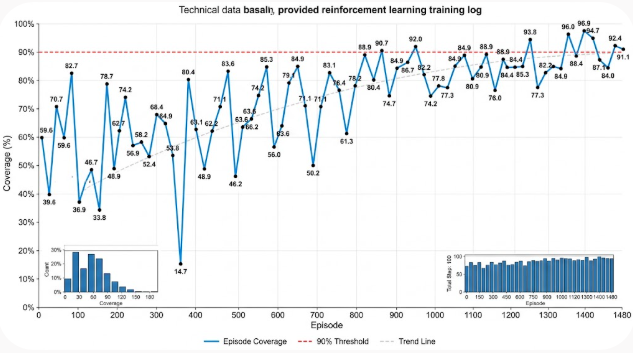
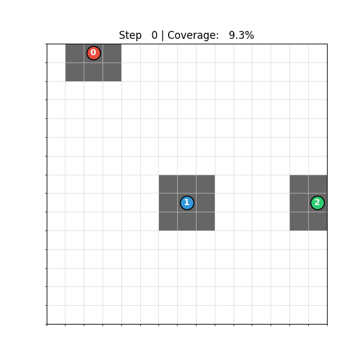
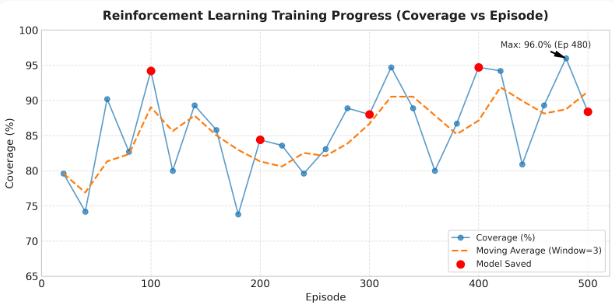
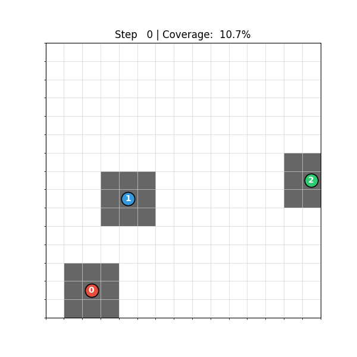
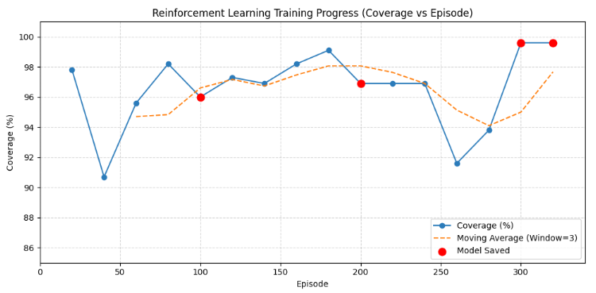

# マルチエージェント強化学習による協調探索 ― 実験の総括

> 対象資料: `src/exe-3/probleme.md`, `src/exe-3/readme.md`, `src/exe-3/doc/*.md`
> 補助資料: リポジトリ直下 `doc/` のMARL理論メモ（MAPPO, CTDE など）
>
> この文書は、断片的な実験メモを **「どんな問題を、なぜ難しく、何を変えたらどこまで解けたのか」** という一本の物語として再構成したものです。マルチエージェント強化学習（MARL）に初めて触れる読者を想定し、専門用語には都度説明を付けています。

---

## ブログ連載「エリアをドローンでマルチエージェント探索」

この実験は、ブログ「[暇さえあればアルゴリズムいじり](https://yoshishinnze.hatenablog.com/)」で **「エリアをドローンでマルチエージェント探索」** として連載されています。各段階の詳細・学習曲線・動作GIFは、以下の記事で確認できます。

| 回 | 公開日 | 内容 | 記事リンク |
|---|---|---|---|
| **連載(1)** | 2026/11/07 | MAPPO＋2D RoPE Transformer＋ハイブリッド報酬。カバレッジ96% | [エリアをドローンでマルチエージェント探索(1)](https://yoshishinnze.hatenablog.com/entry/2026/11/07/043000) |
| **連載(2)** | 2026/11/08 | 学習アルゴリズムをA2POへ変更。学習が安定し、97〜98% | [エリアをドローンでマルチエージェント探索(2)](https://yoshishinnze.hatenablog.com/entry/2026/11/08/043000) |
| **連載(3)** | 2026/11/15 | 待機ペナルティ・隅の重み付け・エゴマップ・skip接続。99.6%／100% | [エリアをドローンでマルチエージェント探索(3)](https://yoshishinnze.hatenablog.com/entry/2026/11/15/043000) |

### 関連記事（前史・理論）

| 内容 | 記事リンク |
|---|---|
| 問題設定（マルチエージェントの強化学習） | [RL: マルチエージェントの強化学習の問題設定](https://yoshishinnze.hatenablog.com/entry/2025/11/29/203803) |
| 最初の試み（不完全燃焼だった探索） | [RL: MARLによる協調動作エージェントの実装](https://yoshishinnze.hatenablog.com/entry/2025/11/30/115017) |
| A2POの解説 | [マルチエージェント強化学習でMAPPOの後継手法A2PO](https://yoshishinnze.hatenablog.com/entry/2026/11/02/043000) |
| MAPPOの解説 | [MAPPOについて](https://yoshishinnze.hatenablog.com/entry/2026/01/10/153824) |
| MARLの全体像・MAPPOの位置づけ | [マルチエージェント強化学習の全体像](https://yoshishinnze.hatenablog.com/entry/2026/02/19/000000) |
| CTDEの解説 | [CTDEについて](https://yoshishinnze.hatenablog.com/entry/2025/11/18/053506) |
| 2D RoPE Transformer（Pursuitでの検証） | [RoPE Transformerによるチーム連携](https://yoshishinnze.hatenablog.com/entry/2026/07/18/043000) |
| GAEの解説 | [GAEについて](https://yoshishinnze.hatenablog.com/entry/2026/07/24/043000) |
| PPOの解説 | [PPOについて](https://yoshishinnze.hatenablog.com/entry/2026/08/10/043000) |
| RoPEの解説 | [RoPEについて](https://yoshishinnze.hatenablog.com/entry/2026/08/06/043000) |
| ドローン配送（別タスク・exe-4） | [過去トライしたドローンの協調学習へリトライ](https://yoshishinnze.hatenablog.com/entry/2026/10/24/043000) |

> 連載(1)が第1段階、連載(2)が第2段階、連載(3)が第3段階に対応します。本文中各段階の冒頭にも該当記事へのリンクを置いています。

---

## 0. 3分でわかる総括

### 解いた問題

**15×15マス（225マス）の未知のマップを、3台のドローンが100ステップ以内に100%探索する。**
各ドローンが見えるのは自分の周囲3×3マスだけ。動けるのは「待機・上下左右」の5行動だけ。

### 改善の階段

| 段階 | やったこと | 結果 |
|---|---|---|
| **0. 初期検討** | 共有脳（Shared Brain）DQN＋CNN。全ドローンが1つのQネットワークを共有 | 設計・コードは残るが、満足な性能の記録なし。後に作り直し |
| **1. 基盤構築** | **MAPPO** ＋ **2D RoPE Transformer** ＋ **全体マップ共有** ＋ **ハイブリッド報酬（Fair Split）** | 最大 **96%**。以前より大幅改善したが、学習が遅く、10〜30%台への大崩れが発生 |
| **2. 学習の安定化** | 学習アルゴリズムだけを **MAPPO → A2PO** に変更 | 立ち上がりが Ep800 前後 → **Ep20〜100** に短縮。破壊的更新が消失。ロールアウトで **97〜98%** |
| **3. 最後の数%** | **待機ペナルティ** ＋ **隅ほど大きい報酬** ＋ **エゴマップ** ＋ **ID・位置のskip接続** | 学習曲線で **99.6%**、可視化したロールアウトでは **100%** |

### 一言でいうと

> **「探索の設計（何を見せ、どう報酬を与えるか）」→「学習の安定化（どう更新するか）」→「最後の数%の報酬設計」** の順にボトルネックを潰した。

特に効いたのは、次の3つです。

1. **全体マップの共有**で「もう誰かが行った場所」を全員が知れるようにした
2. **A2PO**で方策の破壊的更新を抑え、学習を安定させた
3. **隅の重み付け報酬**で、センサーの端で見えにくい「最後の3%」を狙わせた

---

## 1. 問題設定

### 1.1 タスクの全体像

| 項目 | 設定 |
|---|---|
| マップ | 15×15 のグリッド（225マス） |
| エージェント | 3台の探索ドローン |
| 観測 | 自分の周囲 3×3 マス（センサー範囲1）＋ チーム共有の探索済みマップ |
| 行動 | 待機、上、下、左、右（5種類） |
| 制限時間 | 1エピソード最大100ステップ |
| 目標 | 100ステップ以内に225マスすべてを探索（カバレッジ100%） |
| 終了条件 | カバレッジ100%に到達、または100ステップ経過 |

イメージとしては、**「視界の狭いロボット掃除機を3台同時に走らせて、部屋全体の床を最短時間で掃除させる」** タスクです。

### 1.2 なぜこの問題が難しいのか

一見「ドローンを動かすだけ」に見えますが、MARLとしては次の5つの難しさがあります。

#### ① 部分観測性（Partial Observability）

各ドローンは自分が見える3×3の範囲しか直接観測できません。全体のどこが未探索かは、**チームで共有するマップ**を通じて間接的に知る必要があります。

#### ② 協調と重複のトレードオフ

- ドローン同士が近くに固まると、同じマスを何度も見てしまい無駄が出る
- 逆に離れすぎると、情報共有や役割分担が難しくなる
- 「3台がどう空間を分割するか」を自分たちで見つける必要がある

#### ③ 信用割り当て（Credit Assignment）

「チーム全体で新しいマスを発見した」という成果に対して、**誰がどれだけ貢献したか**を正しく評価するのが難しい問題です。

- チーム報酬だけを与えると、他人に任せて動かない **フリーライダー（サボり役）** が生まれる
- 個人報酬だけを与えると、他人の成果を横取りしたり、自分勝手に動いたりする

#### ④ 非定常性（Non-stationarity）

自分が学習している間にも、他のドローンも学習して動きを変えます。各ドローンから見ると、**環境のルールが常に変わり続けている**ように見えるため、学習が不安定になります。

#### ⑤ 報酬がスパースで遅い

「100%探索できた」という大きな報酬はエピソードの最後にしか得られません。途中の行動が良かったのか悪かったのかを学ぶのが難しく、**報酬設計（Reward Shaping）** が重要になります。

### 1.3 報酬の設計

最終的に採用された報酬は、**チーム報酬＋個人報酬＋ペナルティ**のハイブリッドです。概念式は次の通りです。

$$
r_{i,t} =
\underbrace{w_{\text{team}} \cdot \frac{\Delta N_{\text{team}}}{S}}_{\text{チーム報酬}}
+
\underbrace{w_{\text{ind}} \cdot \frac{\Delta N_i}{S}}_{\text{個人報酬}}
-
\underbrace{c_{\text{time}}}_{\text{時間ペナルティ}}
-
\underbrace{c_{\text{idle}} \cdot \mathbb{1}[\text{待機}]}_{\text{待機ペナルティ}}
+
\text{（完了ボーナス）}
$$

| 記号 | 意味 |
|---|---|
| $\Delta N_{\text{team}}$ | チーム全体が新しく発見したマス数 |
| $\Delta N_i$ | エージェント $i$ が新しく発見したマス数（按分後） |
| $S$ | センサー面積（3×3＝9）。報酬スケールを揃えるための正規化 |
| $w_{\text{team}}, w_{\text{ind}}$ | チーム報酬・個人報酬の重み |
| $c_{\text{time}}$ | 1ステップごとの時間ペナルティ（-0.1） |
| $c_{\text{idle}}$ | 待機を選んだときの追加ペナルティ（-0.3） |

#### Fair Split（公平な按分）

複数のドローンが**同時に同じ未探索マス**を発見した場合、そのマスの報酬を発見者数 $k$ で割ります。

$$
\Delta N_i = \sum_{\text{自分が発見したマス}} \frac{1}{k_{\text{そのマスを同時発見した人数}}}
$$

これにより、

- 固まって同じ場所を探索すると報酬が薄まる
- 単独で新しい領域を開拓すると満額もらえる

というインセンティブが生まれ、**自然に散らばる動き**を促します。また、旧実装にあった「同じマスを複数人で発見すると報酬が二重・三重に支払われる」バグも解消しています。この二重カウントは「固まるほど得」という真逆のインセンティブを生み、学習不安定化の主因になっていました。

#### 隅の重み付け（第3段階で追加）

マップ中心を1.0倍、四隅を2.0倍とする重みマップを作り、新規発見報酬に掛けます。センサーが端でクリップされて一度に見えるマスが少ない「隅」を、報酬で底上げする狙いです。

---

## 2. 初めての人のための前提知識

ここでは、本文を読むために必要な最低限の用語を説明します。すでに慣れている方は第3節まで飛ばしてください。

### 2.1 強化学習（RL）の基本

強化学習では、エージェントが環境の中で試行錯誤し、**報酬を最大化する行動の選び方（方策）** を学びます。

| 用語 | 意味 |
|---|---|
| **状態 $s$** | 今の状況（この問題ではマップの探索状況＋ドローンの位置） |
| **観測 $o$** | エージェントが実際に見える情報（部分観測では $s$ の一部） |
| **行動 $a$** | エージェントが選ぶ操作（上下左右・待機） |
| **報酬 $r$** | 行動の良さを表す数値 |
| **方策 $\pi(a\mid s)$** | 状態から行動を選ぶ確率分布。これが学習の成果物 |
| **価値 $V(s)$** | その状態から将来得られる報酬の期待値。「この状況はどれくらい良いか」 |
| **アドバンテージ $A(s,a)$** | 「その行動は平均よりどれくらい良かったか」。$A = Q(s,a) - V(s)$ |
| **エピソード** | 1回の試行（スタートから終了まで） |
| **ステップ** | エピソード内の1回の行動 |

### 2.2 マルチエージェント強化学習（MARL）の難しさ

エージェントが1台なら「環境は自分が動かさない限り変わらない」という前提が成り立ちます。しかし複数台になると、

- 他のエージェントも勝手に動く
- 自分の行動が他のエージェントの報酬にも影響する
- 誰の貢献か分からない

という問題が生じます。これが **非定常性** と **信用割り当て** です。

### 2.3 CTDE（集中学習・分散実行）

MARLで最もよく使われる設計思想が **CTDE（Centralized Training, Decentralized Execution）** です。

| フェーズ | Actor（行動する側） | Critic（評価する側） |
|---|---|---|
| **学習時** | 自分の観測から行動を選ぶ | **全エージェントの情報**を見て「チームにとってこの状況は良いか」を評価 |
| **実行時** | 自分の観測だけで行動する | 使わない |

「学習時は全員の情報を使って賢くなり、実行時は各ドローンが自分だけの情報で動く」という設計です。これにより、**通信に頼らず分散的に動ける**方策を学べます。

### 2.4 MAPPO（Multi-Agent PPO）

**MAPPO** は、シングルエージェントで実績のある **PPO（Proximal Policy Optimization）** をMARLに拡張した、現在のデファクトスタンダードの一つです。

#### PPOの考え方

方策を一度に大きく変えると、それまで学んだ良い行動を忘れてしまいます。PPOは、

$$
\text{ratio} = \frac{\pi_{\text{new}}(a\mid s)}{\pi_{\text{old}}(a\mid s)}
$$

が **0.8〜1.2** の範囲を超えたら更新を止める（クリップする）ことで、「今までの方策から大きく外れない範囲で少しずつ改善する」ことを保証します。

#### GAE（Generalized Advantage Estimation）

「その行動が平均よりどれくらい良かったか」を、将来の報酬も含めて推定する方法です。割引率 $\gamma$ と、バイアスと分散のバランスを取る $\lambda$ を使います。

$$
A_t = \sum_{l=0}^{\infty} (\gamma\lambda)^l \delta_{t+l},
\qquad
\delta_t = r_t + \gamma V(s_{t+1}) - V(s_t)
$$

この実験では $\gamma = 0.99$、$\lambda = 0.95$ が使われています。

#### MAPPOの特徴

- **集中Critic**: 全エージェントの情報を見て価値を評価
- **パラメータ共有**: 全エージェントが同じネットワークの重みを共有し、サンプル効率を上げる
- **Agent ID**: パラメータを共有する代わりに「自分が何番機か」を入力して役割を区別する
- **PPOの安定性**: クリッピングで急激な方策変化を防ぐ

> **補足**: この実験の実装では、共有バックボーンから各エージェント用の `critic_head` が独立した価値を出力する構造になっています。厳密な「単一の集中Critic」ではなく、**全員の情報を見る共有エンコーダ＋エージェント別の価値ヘッド**と考えると理解しやすいです。

### 2.5 Transformer と 2D RoPE

#### Transformer

Transformerは、複数のトークン（ここではグリッドの各マス）同士の関係を **Self-Attention** で計算するネットワークです。「右上に大きな未探索領域がある」「仲間が左にいる」といった**空間的な関係**を、固定のルールではなく学習で捉えられます。

#### 2D RoPE（Rotary Position Embedding）

通常のTransformerは1次元の並びしか扱えません。2D RoPEは、グリッドの $x$ 座標と $y$ 座標を回転行列でQuery・Keyに埋め込み、**「右に2マス、上に3マス」のような相対的な距離感**をAttentionに直接組み込みます。

これにより、

- 近くのマスほど強く注目する
- 自分と仲間の位置関係を空間的に理解する
- 未知のグリッドサイズにも外挿しやすい

といった利点が生まれます。このリポジトリでは、Pursuit（追跡）タスクで2D RoPE Transformerの有効性が確認されており、その知見を探索問題に持ち込んでいます。

### 2.6 A2PO（Agent-by-agent Policy Optimization）

**A2PO** は「エージェントを1体ずつ順番に更新する」MARLアルゴリズムです。MAPPOが全エージェントを同時に更新するのに対し、A2POは

1. エージェント $i$ を更新する
2. その結果、他のエージェントから見た環境（他の方策）が変わる
3. その変化を補正しながら、次のエージェントを更新する

という手順を踏みます。**「更新する順番が性能に影響する」** という事実を正面から扱った手法で、詳細は第6節で説明します。

### 2.7 用語早見表

| 用語 | 一言説明 |
|---|---|
| **MARL** | 複数エージェントが同時に学習する強化学習 |
| **部分観測** | 各エージェントが環境の一部しか見えないこと |
| **方策（Policy）** | 状態から行動を選ぶルール。学習の成果物 |
| **価値（Value）** | 状態の良さを表す将来報酬の期待値 |
| **アドバンテージ** | 行動が平均よりどれだけ良かったか |
| **CTDE** | 学習時は集中、実行時は分散 |
| **パラメータ共有** | 全エージェントが同じネットワークを共有 |
| **Agent ID** | 共有ネットワーク上で自分を識別するための埋め込み |
| **GAE** | アドバンテージを安定して推定する方法 |
| **PPOクリップ** | 方策の急変を防ぐ更新幅の制限 |
| **Reward Shaping** | 学習を導くために報酬を追加・加工すること |
| **Credit Assignment** | 誰の貢献かを割り当てること |
| **フリーライダー** | 他人に任せて自分は動かないエージェント |
| **非定常性** | 他のエージェントの学習で環境の見え方が変わること |
| **RoPE** | 位置関係をAttentionに埋め込む位置エンコーディング |
| **エゴマップ** | 自分視点で「自分・他者・探索済み」を表した地図 |
| **ロールアウト** | 学習後の方策で実際にエピソードを走らせて評価すること |

---

## 3. 試行錯誤の全体像

| 段階 | 主な変更 | 変えたレイヤ | 記録 |
|---|---|---|---|
| **0. 初期検討** | Shared Brain DQN（CNN＋経験再生＋ターゲットネットワーク） | モデル・学習法 | `probleme.md`, `doc/agent.md` |
| **1. 基盤構築** | MAPPO＋2D RoPE Transformer＋全体マップ共有＋ハイブリッド報酬 | 学習法・モデル・観測・報酬 | `readme.md` |
| **2. 安定化** | MAPPO → A2PO（Pre-OPC、Semi-greedy、Adaptive clipping） | 学習法のみ | `doc/with_a2po.md` |
| **3. 最後の数%** | 待機ペナルティ、隅の重み付け、エゴマップ、skip接続 | 報酬・観測・モデル | `doc/2_with_a2po.md` |

> **重要な進め方**: 第2段階では**学習アルゴリズムだけ**を変え、ネットワークと報酬は据え置いています。第3段階では環境の報酬とモデルを変えています。**一度に全部を変えない**ことで、「何が効いたのか」を切り分けられるようにしています。

---

## 4. 第0段階：Shared Brain DQN

> **対応するブログ記事（前史）**: [RL: MARLによる協調動作エージェントの実装](https://yoshishinnze.hatenablog.com/entry/2025/11/30/115017)
> 連載(1)の冒頭で「不完全燃焼だった」と振り返られている、最初の探索の試みです。

### 4.1 設計

初期の検討では、**Deep Q-Network（DQN）** をベースにした「共有脳」アプローチが提案されました。

| 要素 | 内容 |
|---|---|
| マップ | 10×10（初期コード） |
| エージェント | 3台 |
| 入力 | 2チャンネルの画像：①探索済みマップ ②自分の位置（One-hot） |
| ネットワーク | Dueling DQN＋CNN（畳み込み2層＋全結合） |
| 共有方法 | 3台が**1つのQネットワークの重みを共有** |
| 学習 | 経験再生バッファ、ターゲットネットワーク、ε-greedy |
| 報酬 | チーム全体の新規発見マス数 − 時間ペナルティ |

**狙い**は、3台が同じ脳を共有することで学習データを3倍の効率で集め、CNNで「どこが未探索か」という空間的特徴を抽出することでした。

### 4.2 なぜ限界だったのか

DQNアプローチには、この問題に固有の次の弱点があります。

#### ① 状態空間が膨大

マップの各マスが「探索済み／未探索」の2状態を取るため、探索状態だけで $2^{225}$ 通り（15×15の場合）あります。テーブル型Q学習では到底扱えず、関数近似が必須です。

#### ② チーム報酬だけではフリーライダーが生まれる

「チーム全体の新規発見数」だけを報酬にすると、自分が動かなくても仲間が探索してくれれば報酬がもらえます。すると「サボる」方が得になり得ます。

#### ③ 個人報酬の二重カウント

逆に個人報酬を単純に与えると、複数人が同じマスを同時発見したときに報酬が重複して支払われ、「固まるほど得」という真逆のインセンティブが生まれます（後にFair Splitで修正）。

#### ④ 役割分担の手がかりがない

2チャンネル（探索済みマップ＋自分の位置）だけでは、「自分は誰か」「仲間がどこにいるか」という情報が弱く、空間的な役割分担を学ぶ手がかりが不足します。

#### ⑤ 経験再生と非定常性の相性が悪い

DQNは過去の経験をランダムに再利用しますが、他のエージェントが学習で変化すると、古い経験が現在の方策と噛み合わなくなります。MARLではこれが学習の不安定化につながります。

### 4.3 この段階の教訓

- **「1つの脳を共有する」だけでは不十分**。観測表現・報酬設計・学習アルゴリズムの3つが揃って初めて機能する
- 大規模な探索問題では、**モデルベースの空間認識（Transformer/RoPE）** や **安定した方策勾配法（PPO系）** が有効
- 報酬の二重カウントのような**実装レベルのバグ**が、学習全体を壊すことがある

---

## 5. 第1段階：MAPPO ＋ 2D RoPE Transformer ＋ ハイブリッド報酬

> **対応するブログ記事**: [エリアをドローンでマルチエージェント探索(1)](https://yoshishinnze.hatenablog.com/entry/2026/11/07/043000)

### 5.1 3本柱

第1段階では、問題を次の3つの柱で解こうとしました。

| 柱 | 内容 | 狙い |
|---|---|---|
| **① 全体マップの完全共有** | 全エージェントが共通の `explored_map` を観測として受け取る | 「もう誰かが探索した場所へ行く必要はない」を認知させ、重複を防ぐ |
| **② 2D RoPE Transformer ＋ Agent ID** | 各ドローンにID（0,1,2）を付与し、2D RoPEでグリッド上の絶対・相対位置をAttentionに埋め込む | 「自分は左上、あいつは右下」といった**動的な空間分割・役割分担**を自己組織化する |
| **③ ハイブリッド報酬（Fair Split）** | チーム報酬＋個人貢献報酬。同時発見時は人数で按分 | フリーライダーを防ぎつつ、固まると報酬が薄まる構造で**分散探索**を促す |

### 5.2 モデルの全体像

```
[全体マップ画像] ───(CNN)───> [マップの特徴] ─┐
[エージェント位置] ──(2D RoPE)─> [空間位置表現] ─┼─> [Transformer] ─> 各ドローンの次の行動
[エージェント ID] ─(Embedding)─> [識別用ID]   ─┘
```

- **位置関係の把握（2D RoPE）**: 15×15グリッド上の「絶対位置」と「ドローン同士の相対距離」をTransformerに正しく認識させる
- **IDの付与**: エージェントごとに固有IDを持たせ、「自分はドローン0だから左上を担当しよう」といった**ロールの獲得**を可能にする

### 5.3 学習アルゴリズム：MAPPO

- **CTDE**: 学習時は全体情報を使い、実行時は各ドローンの観測だけで動く
- **個別アドバンテージ**: 各ステップのハイブリッド報酬を元に、エージェントごとのアドバンテージを計算
- **PPO-Clip**: 方策の急変を防ぐ
- **GAE**: 将来の報酬を考慮したアドバンテージ推定
- **Entropy Bonus**: 探索の多様性を維持

### 5.4 結果

- **以前のDQNベースの試みと比べて大幅に改善**。Pursuitで検証済みの「2D RoPE Transformer＋MAPPO」の組み合わせが、探索問題にも有効に機能した
- 学習後のロールアウトで **カバレッジ96%** まで到達
- 3台がおおむね分担して広域を開拓する動きを獲得





### 5.5 残った課題

| 課題 | 内容 |
|---|---|
| **立ち上がりが遅い** | 80%台に安定して乗るまで Ep800 前後、90%台に到達するまで Ep800〜900 が必要 |
| **破壊的更新** | 10〜30%台への突発的な大崩れが発生（例: Ep360周辺で14.7%） |
| **96%の壁** | 最高96%で頭打ち。最後の4%が埋まらない |
| **初期探索の対称性** | 赤と青のエージェントが同じ方向に進んでしまう |
| **報酬の二重カウント** | Fair Split導入前の実装で、同時発見時に報酬が重複していた |

---

## 6. 第2段階：A2PO による学習の安定化

> **対応するブログ記事**: [エリアをドローンでマルチエージェント探索(2)](https://yoshishinnze.hatenablog.com/entry/2026/11/08/043000)

### 6.1 なぜアルゴリズムを変えたのか

第1段階の最大の問題は、**性能の絶対値よりも学習の不安定さ**でした。

MAPPOは全エージェントを同時に更新します。しかし、エージェント $i$ の更新によって他のエージェントから見た環境が変わるため、**「今のデータは本当に現在の方策のものか？」** というズレ（非定常性）が生じます。これが破壊的更新や遅い立ち上がりの原因と考えられました。

そこで、**エージェントを1体ずつ順番に更新し、先行エージェントの変化を補正するA2PO**に着目しました。

> **A2POの論文**: Xihuai Wang et al., "Order Matters: Agent-by-agent Policy Optimization", ICLR 2023 (arXiv:2302.06205)

### 6.2 A2POの3つの機構

#### ① Pre-OPC（Preceding-agent Off-Policy Correction）

先行して更新されたエージェントの方策変化を、**Retrace風の打ち切り重要度サンプリング**で補正します。

$$
c_t = \min\left(1,\ \prod_{j \in \text{preceding}} \frac{\pi_j^{\text{new}}(a_j\mid s)}{\pi_j^{\text{old}}(a_j\mid s)}\right)
$$

GAEの再帰計算にこの $c_t$ を掛けます。

```python
gae = delta + GAMMA * LAMBDA * c_next * gae
```

- `preceding` が空集合（そのステージの最初の更新）なら $c=1$ となり、**通常のGAEと完全に一致**
- 先行エージェントの変化が大きいほど $c$ は1以下に打ち切られ、「その変化が後のアドバンテージに与える影響を割り引く」

#### ② Semi-greedy Agent Selection

どのエージェントから更新するかを、$|\text{advantage}|$ の平均が大きい順に選びます。ただし、**確率0.5で完全ランダム**に選ぶことで早期収束を防ぎます。

```python
if random.random() < SEMI_GREEDY_PROB:   # 0.5
    i_sel = random.choice(list(remaining))
else:
    i_sel = max(remaining, key=lambda a: scores[a])
```

論文のablationでも、純粋なgreedyより性能が安定することが示されています。

#### ③ Adaptive Clipping Parameter

更新順位 $k$ が後になるほど、クリップ幅を広げます。

$$
\epsilon_i = \epsilon_{\text{base}} \cdot c + \epsilon_{\text{base}} \cdot (1-c) \cdot \frac{k}{N}
$$

理由は、**後から更新されるエージェントほど、先行エージェントの累積的な方策変化に晒されて非定常性の影響を強く受ける**ためです。十分な更新幅を確保しないと、変化に追従できません。

さらに、KLダイバージェンスを用いた目的関数により、**理論上は期待累積報酬の単調改善**が保証されます（単一の共有報酬を前提とした場合）。

### 6.3 理論と実装のギャップ（重要）

A2POの単調改善保証は、**全エージェントが同じ報酬 $r(s,a)$ と同じ価値関数 $V(s)$ を共有するDEC-MDP**を前提に証明されています。しかし、このプロジェクトの環境は、

- 個人貢献報酬＋チーム協調報酬の**ハイブリッド報酬**
- `critic_head` がエージェントごとに**独立した価値**を出力

という構造です。そこで、Pre-OPC補正を**各エージェント自身の報酬・価値関数**に対して適用する実務的な拡張として実装しています。

> **注意**: この拡張により、論文が証明する**厳密な単調改善保証はそのままでは成立しません**。改善は「理論保証の帰結」ではなく、**経験的な効果**として解釈する必要があります。それでも、非定常性を緩和するという設計思想はそのまま活きます。

#### 共有バックボーンによる「意図しない全体方策シフト」

このモデルは `map_encoder` やTransformer Blockの重みを**全エージェントで共有**しています。あるエージェントの損失で逆伝播すると、そのエージェントのヘッドだけでなく**共有バックボーン全体**が更新され、まだ更新していないエージェントの出力まで変わってしまいます。

A2POの理論は「エージェント $i$ を更新する間、他のエージェントの方策は変化しない」ことを前提にしているため、これは理論との大きなギャップです。対策として、

- `clip_grad_norm_` の閾値を小さくする
- 学習率を下げる
- `A2PO_STAGES` を減らして、1ステージあたりの共有重み変化を抑える

といった調整が推奨されています。

#### 計算コスト

1エージェント更新につき、

- 現在の方策を全タイムステップで評価する `no_grad` パス（アドバンテージ計算・エージェント選択用）
- 勾配を通す実際の更新用パス

の2回、トラジェクトリ全体をforwardします。計算量は

$$
2 \times T \times N \times \text{A2PO\_STAGES}
$$

に比例し、MAPPOの $T \times \text{PPO\_EPOCHS}$ より重くなります。そのため `A2PO_STAGES=2` に抑え、計算コストと更新回数のバランスを取っています。

#### 数値的な不安定性

複数エージェント分のlog-probの和を `exp` で戻すため、方策が大きく動くと比率が極端に小さくなり（アンダーフロー）、アドバンテージ推定が実質1ステップのTD誤差に退化することがあります。学習曲線が不自然に平坦化していないか監視が必要です。

### 6.4 結果

| 指標 | 第1段階（MAPPO） | 第2段階（A2PO） |
|---|---|---|
| 80%台に安定して乗るまで | Ep800 前後 | **Ep20〜100** |
| 90%到達 | Ep800〜900 | **Ep60（90.2%）** |
| 最高カバレッジ（学習曲線） | 96.0% | **96.0%（Ep480）** |
| 最低エピソード | 14.7%（Ep360周辺） | **73.8%（Ep180）** |
| 10〜30%台への大崩れ | あり | **完全に消失** |
| 評価ロールアウト | 96% | **97〜98%** |
| 平均カバレッジ | ― | 86%前後（80%台と90%超を周期的に行き来） |





### 6.5 結果の解釈

**最も重要なのは、性能の絶対値よりも「学習の安定性」が改善したこと**です。

- **立ち上がりの高速化**: Ep20〜100で平均80%以上を維持
- **破壊的更新の消滅**: 最低エピソードが73.8%に留まり、方策の崩壊が起きにくい
- **90%到達の早期化**: Ep60で90.2%

これは「KLベースの目的関数＋保守的クリップ」が方策破壊を抑え、「Pre-OPC」が共有バックボーン経由の意図しない方策シフトを緩和した結果と読めます。**非定常性の抑制というA2POの設計思想が、共有パラメータの大きい本環境の弱点に刺さった**という構図です。

ただし、**平均86%前後で高止まりし、80%台と90%超を周期的に行き来する**という課題は残りました。これは環境の初期配置のランダム性や、残存する探索パラメータ（ε-greedyの残り、アクターの分散など）による変動と考えられています。**「収束しきっていない」状態**であり、96%も再現性のある水準とは言い切れません。

また、**初期探索の対称性**（赤と青が同じ方向へ進む）も未解決で、序盤の重複探索が終盤の取りこぼしに直結していました。

---

## 7. 第3段階：報酬 shaping と自己認識の強化で最後の数%を埋める

> **対応するブログ記事**: [エリアをドローンでマルチエージェント探索(3)](https://yoshishinnze.hatenablog.com/entry/2026/11/15/043000)

### 7.1 現状の課題と仮説

A2POで97〜98%まで来ましたが、100%には届いていません。残った課題に対して、次の3つの仮説を立てました。

| 仮説 | 内容 | 弱点・注意 |
|---|---|---|
| **① 待機ペナルティ** | 待機が有利になる場面はほぼないので、待機に直接ペナルティを付ける | 壁に向かって移動して位置が変わらないケースは `action==0` ではないのでペナルティを受けない。強くしすぎると「とにかく動く」ことが優先される |
| **② 隅ほど大きい報酬** | 隅はセンサーが端でクリップされ、一度に見えるマスが少ないので探索が後回しになりやすい。隅を報酬で底上げする | 根拠は推測で、実際に隅の探索が遅れているかは未確認。目的関数そのものを変えるため、本当の目標（最短で100%カバレッジ）とずれる可能性がある |
| **③ IDと自己位置の強化** | Transformerを通る間にID・位置情報が薄まるのでは。headへの直接入力（skip接続）と、地図上に自分・他者を描くエゴマップで補強する | RoPEですでに座標を使っているため、追加効果は不明。パラメータが増える分、学習が遅く・不安定になる可能性 |

### 7.2 実装した変更

A2POのアルゴリズム本体（Pre-OPC、Semi-greedy、Adaptive clipping）は**一切変えていません**。

| # | 変更対象 | 内容 | 目的 |
|---|---|---|---|
| 1 | 環境（報酬） | 待機ペナルティ、隅ほど大きい報酬 | サボり防止、隅の探索促進 |
| 2 | モデル | エゴマップ入力、ID・位置のskip接続 | 「自分は誰でどこにいるか」を効かせる |
| 3 | A2PO・可視化スクリプト | 上記モデル設定を明示的に反映 | 学習時と可視化時の構造を一致させる |
| 4 | チェックポイント読み込み | 一致する重みだけ読み込む関数を追加 | 構造変更後もエラーなく再開 |

#### ① 待機ペナルティ

`action==0`（待機）を選ぶと、時間ペナルティ（-0.1）に加えて `IDLE_PENALTY`（-0.3）が科されます。待機すると合計 **-0.4**、動けば **-0.1** です。

#### ② 隅ほど大きい報酬

マップ中心を1.0倍、四隅を2.0倍（`EDGE_WEIGHT_SCALE=1.0` のとき）とする重みマップを作り、新規発見マスの報酬に掛けます。チーム報酬と個人報酬の両方に適用しています。

#### ③ エゴマップ（`EGO_MAP`）

エージェントごとに「探索済み・自分の位置・他者の位置」の**3チャンネル地図**を作り、専用CNNで符号化してエージェントトークンに加算します。地図上で自分と仲間の位置が分かるようになります。

#### ④ ID・位置のskip接続（`AGENT_INFO_SKIP`）

Transformer出力にID埋め込みと位置埋め込みを連結してから、actor/critic headに渡します。行動決定の直前にID・位置が直接届きます。head入力は64次元から192次元になりました。

#### ⑤ チェックポイントの互換読み込み

旧チェックポイントを新モデルに `load_state_dict` すると、`ego_encoder` が無いこととheadの形状が違うことでエラーになります。そこで `load_compatible_state_dict()` を追加しました。

- 名前と形状が一致する重みだけを読み込む
- `copy_overlap=True` なら、headのように入力次元が増えた層は、旧64入力分を引き継ぎ、増えた分は0で始める
- 読み込み結果の内訳を表示する

### 7.3 結果

- **カバレッジのベースラインが大幅に上昇**: 約91%〜99.6%で推移
- **300エピソード以降でほぼ100%（99.6%）に到達**し、安定した収束を示す
- 前回（A2POのみ）は500エピソードかけても74%〜95%の範囲で上下動が大きく、最高96.0%だった
- **可視化したロールアウトでは探索率100%**。エージェントは同じ方向で探索するが、全領域を探索
- 端についても重要箇所を見つけて探索に行く動作が確認できる
- 仲間が探しに行くとサボっているような様子も見られる（笑）




### 7.4 何が効いたのか

| 変更 | 効果 | 理由 |
|---|---|---|
| **待機ペナルティ（-0.4）** | エージェントの「サボり」を防止 | 動かない選択肢を明示的に不利にし、全エージェントが常に探索に参加するインセンティブを与えた |
| **隅の重み付け報酬（最大2.0倍）** | 探索の最後の3%をカバー | センサーがクリップされて見えにくい隅を、報酬で底上げすることで後回しにされにくくした |
| **エゴマップ** | 重複探索の削減 | 「仲間がもうそこを探索している」ことが観測可能になり、無駄な重複が減少 |
| **skip接続** | 役割分担の促進・自己位置推定の安定化 | IDと位置がheadに直接届くことで、各エージェントが異なる領域を担当する協調行動を学びやすくなった |

特に**隅の重み付け**は、97%頭打ちからの脱却に決定的でした。探索率が高くなると、残りの未探索領域は「見つけにくい場所」に集中します。人間が直感で「隅は見えにくい」と推測し、それを報酬設計に反映したことが、最後の数%を埋める鍵となりました。

### 7.5 注意点

- 環境の報酬とモデル構造が両方変わっているため、**以前のA2PO・MAPPOの学習結果とは単純に比較できません**
- 隅の重み付けは**目的関数の歪み**になり得ます。「最短で100%カバレッジ」が本当の目標なら、重み付けが最適化の方向をずらす可能性があります
- 99.6%は学習曲線上の値、100%は**可視化した1エピソード**の値です。複数シードでの再現性は未確認です
- 初期探索の対称性（同じ方向に進む）は依然として残っています

---

## 8. 改善の因果マップ

```
【ボトルネック】                 【打ち手】                         【結果】

重複探索が多発          ←──  全体マップ共有 ＋ エゴマップ      ──→  無駄な重複が減少
役割分担ができない      ←──  Agent ID ＋ 2D RoPE ＋ skip接続   ──→  空間分割の自己組織化
フリーライダーが発生    ←──  チーム＋個人のハイブリッド報酬    ──→  全員が探索に参加
                              ＋ Fair Split ＋ 待機ペナルティ
信用割り当てが難しい    ←──  エージェント別の価値・アドバンテージ ──→  個々の貢献を評価
学習が破壊的に不安定    ←──  PPOクリップ → A2PO               ──→  10〜30%台の大崩れが消失
立ち上がりが遅い        ←──  A2POの逐次更新 ＋ Semi-greedy    ──→  Ep20〜100で80%超
最後の3%が埋まらない    ←──  隅の重み付け報酬                  ──→  99.6%／ロールアウト100%
```

### 課題と打ち手の対応表

| 課題 | 打ち手 | なぜ効くか | 結果 |
|---|---|---|---|
| 重複探索 | 全体マップ共有、エゴマップ | 全員が「探索済み」を共有し、仲間の位置も見える | 96% → 97%台 |
| 役割分担の欠如 | Agent ID、2D RoPE、skip接続 | 自分と他者の位置関係をAttentionに直接埋め込む | 同方向ながら全領域を網羅 |
| フリーライダー | チーム＋個人報酬、Fair Split、待機ペナルティ | サボると損、固まると報酬が薄まる | 全員が探索に参加 |
| 信用割り当て | エージェント別価値、個別アドバンテージ | 誰の行動が良かったかを個別に評価 | 学習効率が向上 |
| 学習の不安定さ | PPOクリップ、A2PO | 更新幅を制限し、先行エージェントの変化を補正 | 破壊的更新が消失 |
| 遅い立ち上がり | A2POの逐次更新、Semi-greedy | 改善量の大きいエージェントを優先して更新 | Ep800 → Ep20〜100 |
| 最後の3% | 隅の重み付け報酬 | 見えにくい場所を報酬で底上げ | 99.6%／100% |

---

## 9. 最終結果

### 9.1 段階ごとの比較

| 段階 | アルゴリズム | 主な変更 | 学習曲線 | 評価ロールアウト | 安定性 |
|---|---|---|---|---|---|
| **0** | Shared DQN | CNN＋共有脳 | 記録なし | 未達 | ― |
| **1** | MAPPO | RoPE Transformer、全体マップ、ハイブリッド報酬 | 最大96%、90%到達に800〜900ep | 96% | 10〜30%台の大崩れあり |
| **2** | A2PO | 学習ループのみ変更 | 平均86%、最大96.0%、Ep20〜100で80%超 | 97〜98% | 大崩れ消失、最低73.8% |
| **3** | A2PO＋shaping | 待機ペナルティ、隅の重み、エゴマップ、skip | 91〜99.6%、300ep以降ほぼ99.6% | 100%（1エピソード） | 高いが周期的ブレは残る |

### 9.2 何がどこまで解決したか

| 項目 | 状態 |
|---|---|
| 重複探索の削減 | ✅ 大幅改善 |
| フリーライダー対策 | ✅ 改善（ただしサボりっぽい動きは残る） |
| 学習の安定性 | ✅ 大幅改善（破壊的更新が消失） |
| 立ち上がりの速さ | ✅ 大幅改善（Ep800 → Ep20〜100） |
| 96%の壁 | ✅ 突破（99.6%／100%） |
| 100%の再現性 | ⚠️ 未確認（複数シード・決定論的評価が必要） |
| 初期探索の対称性 | ❌ 未解決（同じ方向に進む） |
| 計算コスト | ⚠️ 増大（A2POはforward回数が多い） |
| 理論保証 | ⚠️ 個別報酬への拡張で厳密な保証はなし |

---

## 10. この実験から学べること（一般原則）

### ① 学習アルゴリズムの安定性が、性能の土台になる

MARLでは、エージェント同士の相互作用で方策更新が非定常になり、破壊的更新が頻発します。A2POのような安定化技術がないと、**高性能な方策に到達する前に学習が崩壊**します。まず安定させ、その上で性能を伸ばす順番が重要です。

### ② 報酬設計は「探索の盲点」を狙い撃ちできる

- 待機・停止にペナルティを与えると、フリーライダーを抑えられる
- センサー特性や地形で「見つけにくい場所」を報酬で底上げすると、最後の数%を埋められる
- ただし、重み付けは**目的関数の歪み**になり得る。本当の目標と整合しているか注意する

### ③ 観測の「見える化」が協調を生む

- グローバルな情報をそのまま渡すより、**エゴセントリックな地図**（自分・他者・探索済み）を与える方が、協調行動を学びやすい
- Transformerのような強力なモデルでは情報が「薄まる」ことがある。**skip接続や専用エンコーダ**で、行動決定の直前に自己・他者情報を注入するのが有効
- RoPEに加えて地図ベースの位置情報を併用するなど、**座標を異なる形態で多角的に与える**と空間認識が頑健になる

### ④ 一度に全部を変えない

第2段階では学習アルゴリズムだけ、第3段階では報酬とモデルを変更しています。**同時に全部を変えると、何が効いたか分からなくなります**。改善はレイヤーごとに分離して評価するのが鉄則です。

### ⑤ 可視化は必須

数値（カバレッジ）だけでなく、**GIFなどでエージェントの動きを確認**することで、「重複探索」「サボり」「隅の探索」といった問題を直感的に発見できます。

### ⑥ 理論と経験のバランス

A2POの厳密な単調改善保証は、個別報酬・個別価値関数への拡張で成立しません。それでも経験的に大きな改善が得られました。**理論を無視するのではなく、「理論的に不完全でも経験的に強い手法を、リスクを理解した上で活用する」** 姿勢が重要です。同時に、どこで理論が崩れているかを明示することも誠実さです。

### ⑦ チェックポイントの互換性を確保する

モデル構造を変更するときは、`load_compatible_state_dict` のような関数で学習済み重みを部分的に引き継ぐ仕組みを用意すると、ゼロからやり直さずに済みます。

---

## 11. 残っている課題と次の一手

### 11.1 診断（まず原因を特定する）

- **未訪問セルのヒートマップ**を作り、「どのセルが・どの初期配置で・何ステップ目に取りこぼされるか」を可視化する。失敗の型が決まれば、報酬・カリキュラム・ネットワークのどれを触るべきか切り分けられる
- **複数シード×決定論的方策**で評価し、99.6%や100%が実力値か分散の産物かを確認する

### 11.2 探索の多様性と報酬設計

- **初期探索方向の対称性を崩す**: エージェント埋め込みの強化、序盤に限定した探索ボーナス（未訪問カウント／好奇心）の減衰スケジューリング
- **Potential-based shaping**（未訪問セルへの距離ベース報酬）を導入する。理論的な方策不変性が保証されるため、既存の報酬系を壊さずに「残り数%への勾配」だけを足せる
- **カバレッジ達成率に対する非線形な終盤ボーナス**（例: 残り1%の価値を大きくする）で、96%→100%の勾配を急峻にする
- 終盤のε-greedy残量・アクター分散のアニーリングを最後まで実施し、周期的ブレの原因を潰す

### 11.3 アルゴリズム側の追い込み

- 共有バックボーンの影響が大きいなら、**エージェント固有パラメータの比率を上げる**（アダプタ／LoRA的な分離）。「preceding比率を定数扱い」では防げない問題への構造的な対策になる
- `A2PO_STAGES`、Semi-greedy確率、クリップ幅、学習率を調整する
- preceding比のアンダーフローで学習曲線が平坦化していないかを監視する

### 11.4 コミュニケーションの導入

- 現状は「全体マップの共有」という暗黙の情報共有のみ。**意図共有（MAPPO-PIS）** や **動的通信グラフ（ICP-MAPPO）** のような明示的なコミュニケーションを導入すれば、初期の役割分担をより確実にできる可能性がある

---

## 付録A：元資料ガイド

| ファイル | 内容 | 物語上の位置 |
|---|---|---|
| `probleme.md` | 災害現場の探索問題の設定、環境 `MultiSensorSearchEnv` の解説、DQN導入 | 問題設定と第0段階 |
| `doc/agent.md` | Shared Brain DQN（CNN＋経験再生＋ターゲットネットワーク）の設計とコード | 第0段階の詳細 |
| `readme.md` | MAPPO＋2D RoPE Transformer＋ハイブリッド報酬の実装と結果（96%）。全体の総括 | 第1段階の総括 |
| `doc/with_a2po.md` | A2POへの差し替え。Pre-OPC、Semi-greedy、Adaptive clippingの実装と理論のギャップ、学習結果 | 第2段階の詳細 |
| `doc/2_with_a2po.md` | 待機ペナルティ、隅の重み付け、エゴマップ、skip接続。99.6%／100%達成とベストプラクティス | 第3段階の詳細 |
| `doc/3_mappo_improvement.md` | **別タスク（ドローン配送、exe-4）** の記録。2D RoPE Transformer＋MAPPO＋CTDEの有効性を確認した前段の知見 | 探索問題の直接の結果ではないが、第1段階の技術選定の根拠 |
| `src/mappo/` | MAPPO実装 | 第1段階のコード |
| `src/a2po/` | A2PO実装 | 第2・3段階のコード |
| `src/env.py` | 探索環境 | 全段階共通 |
| `src/movie_get.py` | ロールアウトのGIF化 | 評価・可視化 |

> **注意**: `doc/3_mappo_improvement.md` はファイル名から探索問題の続編に見えますが、内容は**ドローン配送タスク（exe-4）** の記録です。探索問題の性能推移（96%→97%→99.6%）には含めず、「RoPE Transformerが空間的意思決定に強い」という技術的根拠として参照するのが正確です。

### ブログ連載との対応

このディレクトリの記録は、ブログ連載「エリアをドローンでマルチエージェント探索」の元原稿にあたります。

| 段階 | 対応する記事 |
|---|---|
| 第0段階（前史・最初の試み） | [RL: MARLによる協調動作エージェントの実装](https://yoshishinnze.hatenablog.com/entry/2025/11/30/115017) |
| 第1段階（MAPPO＋RoPE Transformer） | [エリアをドローンでマルチエージェント探索(1)](https://yoshishinnze.hatenablog.com/entry/2026/11/07/043000) |
| 第2段階（A2PO） | [エリアをドローンでマルチエージェント探索(2)](https://yoshishinnze.hatenablog.com/entry/2026/11/08/043000) |
| 第3段階（報酬shaping＋エゴマップ） | [エリアをドローンでマルチエージェント探索(3)](https://yoshishinnze.hatenablog.com/entry/2026/11/15/043000) |
| 別タスク（ドローン配送、exe-4） | [過去トライしたドローンの協調学習へリトライ](https://yoshishinnze.hatenablog.com/entry/2026/10/24/043000) |

### リポジトリ直下 `doc/` の関連理論メモ

| ファイル | 内容 |
|---|---|
| `doc/1-what-multi-agent.md` | MARLの全体像、CTDE、協調と探索の整理 |
| `doc/7-mapo.md` | MAPPOの基本構造、非定常性、集中Critic、パラメータ共有 |
| `doc/16_Successor_methods_to_MAPPO.md` | MAPPOの後続手法（MARPO、MAPPO-PIS、ICP-MAPPO）の比較 |
| `doc/11_Potential_subspace.md` | 潜在空間による探索の多様化（MAVENなど） |
| `doc/13_sample_efficiency.md` | MARLのサンプル効率の難しさ |

---

## 付録B：数字の読み方と注意点

この実験の数値を読むときは、次の点に注意してください。

### ① 学習曲線とロールアウトは別物

- **学習曲線**は、学習中の確率的な方策（探索あり）で記録されたカバレッジ
- **ロールアウト**は、学習後の方策を決定論的に（または低い探索率で）走らせた評価

そのため、「学習曲線の最大96.0%」と「ロールアウト97〜98%」のように、同じ段階でも数字が異なります。どちらの指標かを明示して読む必要があります。

### ② 環境・モデルが変わると単純比較できない

第3段階では報酬とモデル構造の両方を変えています。第2段階との比較は「改善の方向」を示すものではありますが、厳密な ablation（要因分離）ではありません。

### ③ 単一シード・単一ロールアウトの可能性

99.6%や100%は、複数シードでの平均・分散を示したものではありません。再現性の確認には、複数シード×決定論的方策での評価が必要です。

### ④ 「100%」の意味

可視化された1エピソードで100%に到達したことと、**任意の初期配置で安定して100%を達成できること**は別です。後者を示すには、初期配置を変えた多数の評価が必要です。

### ⑤ A2POの理論保証は適用外

A2POの単調改善保証は「単一の共有報酬・価値関数」を前提としています。この実験は個別報酬・個別価値関数に拡張しているため、**理論保証はそのままでは成立しません**。改善は経験的な効果として解釈してください。

### ⑥ 計算コストの増大

A2POは `2 × T × N × STAGES` 回のforwardが必要で、MAPPOより重いです。性能向上と引き換えに、ハイパーパラメータ探索の試行回数が制限される点も考慮が必要です。

---

## 付録C：初学者向け・読む順番

1. **この文書の第0〜2節**で、問題と用語を押さえる
2. **`readme.md`** で、第1段階の全体像と3本柱を掴む
3. **`doc/with_a2po.md`** で、A2POがなぜ効いたかを理解する
4. **`doc/2_with_a2po.md`** で、最後の数%をどう詰めたかを見る
5. 興味に応じて **`doc/7-mapo.md`**（MAPPOの理論）や **`doc/1-what-multi-agent.md`**（MARLの全体像）へ
6. 実装を見るなら **`src/env.py` → `src/mappo/` → `src/a2po/`** の順

---

## むすび

この実験の成功は、**「安定した学習アルゴリズム（A2PO）」＋「探索の盲点を埋める報酬 shaping」＋「自己・他者認識の強化（エゴマップ・skip接続）」** という3つの柱が揃った結果です。

特に、96%から99.6%への向上は「隅の重み付け報酬」と「エゴマップによる重複削減」が鍵でした。一方で、その前段の「A2POによる学習安定化」がなければ、報酬 shapingの効果を正しく測ることもできませんでした。

MARLの協調探索においては、

1. **アルゴリズムの安定性が土台**になり、
2. その上に**報酬設計で探索空間を誘導**し、
3. **観測表現で協調に必要な情報を与える**

という順序で設計することが、100%に近い性能への近道であることが示されています。

そして、まだ残っている「100%の再現性」「初期探索の対称性」「計算コスト」といった課題は、次の実験の出発点です。
