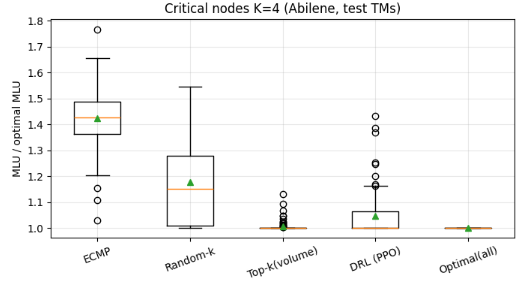
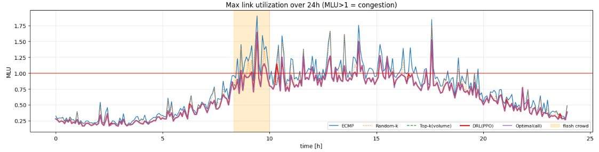
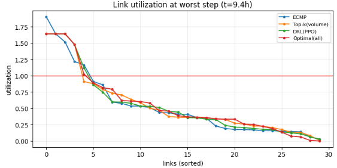

先日[ネットワークの通信のトラフィックを制御理論を用いて動的にクリティカルノードを選定する手法であるDeepScale](https://yoshishinnze.hatenablog.com/entry/2027/01/07/043000)について説明しました。

これが実際にネットワークのネットワークの性能の改善に機能することを検証してみようと思います。

## 論文の実験モチベーション

ScaleDeep（論文タイトル: "Enabling Scalable Routing in Software-Defined Networks With Deep Reinforcement Learning on Critical Nodes"、IEEE/ACM Transactions on Networking 2021年掲載）を実験する意義は、主に以下の3点に集約されます。
尚、以下の文脈では深層強化学習のことを `DRL` と略して説明をしてきます。

### 1. **DRLベースTEの「スケーラビリティ問題」を解決する**

従来のDRLベースのトラフィックエンジニアリング（TE）は、**全ノード・全リンクの情報を状態として入力し、全フローの経路を同時に決定**しようとするため、ネットワークが大きくなると状態空間・行動空間が爆発的に膨張し、学習が収束しにくくなります。ScaleDeepは、**制御理論（pinning control theory）に基づいて「クリティカルノード（driver nodes）」という重要なノードの部分集合のみを選び出し、そこに制御を集中させる**ことで、DRLの状態・行動空間を大幅に圧縮し、大規模ネットワークでも学習が収束するスケーラブルな手法を実現しています。[IEEE/ACM Transactions on Networking](https://doi.org/10.1109/tnet.2021.3126933)

### 2. **トポロジ変化に対する頑健性（ロバスト性）を高める**

既存のDRLベース手法は、学習時のネットワークトポロジに強く依存しており、リンク障害やノード追加などの**軽微なトポロジ変化が起きると性能が大きく劣化**する問題がありました。ScaleDeepは、ネットワーク全体ではなく**クリティカルノードの部分集合に制御を限定**することで、DRLエージェントのトポロジへの依存度を下げ、トポロジ変化があっても性能劣化を抑える頑健性を獲得しています。[IEEE/ACM Transactions on Networking](https://doi.org/10.1109/tnet.2021.3126933)

### 3. **「部分制御」で全体最適に近い性能を達成する**

直感的には「全ノードを制御しなければ最適にならない」と思われがちですが、ScaleDeepは**ネットワークのダイナミクスを支配する少数のクリティカルノードを制御することで、全体を最適化する**というアプローチを示しています。実際、パケットレベルシミュレーションの結果、ScaleDeepは既存のDRLベース手法と比較して**平均フロー完了時間を最大36%削減**し、より高い性能とロバスト性を示しています。[IEEE/ACM Transactions on Networking](https://doi.org/10.1109/tnet.2021.3126933)


### まとめ：このコードで実験する意義

このコードは、ScaleDeepの**核心的なアイデア**（「クリティカルノードをDRLで選択し、部分制御によってスケーラビリティと頑健性を両立する」）を、**LP（線形計画法）を組み合わせた最小実験環境**で検証するものです。具体的には：

- **DRLが「どのノードが重要か」を学習できるか**（Random-kやTop-kヒューリスティックと比較）
- **クリティカルノード数Kを変えたときに、どの程度までMLUが改善するか**（Kの増加と性能向上のトレードオフ）
- **ECMPやヒューリスティック手法に対して、DRLベースの部分制御が優位か**

を確認できるため、ScaleDeepの **「部分制御によるスケーラビリティ向上」という本質的な価値**を、小規模な実装で体験・検証する意義があります。

## 実験方法

続いて、ScaleDeepの効果を検証する実験内容について説明していきます。

### 実験条件

基本はいつものGoogle Colabeで実験を行っていきます。
その上で利用するネットワークトポロジやライブラリなどの条件については以下通りとします。
ざっくりいうと、現実のインターネットバックボーン（Abilene）を模した小規模ネットワークで、都市間の通信パターンを440通り合成生成し、それを学習用とテスト用に分けて検証するという実験を仮定しています。

| 項目 | 内容 |
|---|---|
| **ネットワークトポロジ** | Abilene（12ノード、15リンク） |
| **ノード（都市名）** | ATLAM5, ATLAng, CHINng, DNVRng, HSTNng, IPLSng, KSCYng, LOSAng, NYCMng, SNVAng, STTLng, WASHng |
| **トラフィックデータ** | 合成生成による440個のトラフィック行列（学習用400個、テスト用100個の想定） |
| **トラフィック生成モデル** | 重力モデル＋ホットスポットモデル（`rng.lognormal(0, 0.8)` を使用） |
| **乱数シード** | `SEED = 0`（NumPyの`default_rng`使用、再現性確保） |
| **評価指標** | **MLU（Maximum Link Utilization：最大リンク利用率）**の最小化 |
| **使用ライブラリ** | `gymnasium`, `stable-baselines3`（PPO）, `networkx`, `scipy`, `matplotlib`, `numpy` |

### 実験方法

重要なノードを選択する方法を複数用意した上でネットワークの性能を検証します。

__1. 比較する5種類の手法__

以下の5つの手法を同一条件下で比較し、「どの方法でノードを選ぶとMLUを最小化できるか」を検証します。

| 手法名 | ノード選出の方法 | 制御内容 |
|---|---|---|
| **ECMP** | 全ノード等価（選出なし） | 固定経路（等価コスト多経路） |
| **Random-k** | ランダムにk個のノードを選出 | 選出ノードのリンク重みを調整 |
| **Top-k** | 送信量（トラフィック量）が多い**上位kノード**をヒューリスティックに選出 | 選出ノードのリンク重みを調整 |
| **DRL (PPO)** | 強化学習（PPO）が「どのノードを制御すべきか」を**自動的に学習** | 学習に基づきリンク重みを動的調整 |
| **全ノード最適 (LP)** | 全12ノードを制御（理論下限の算出用） | 線形計画法（LP）で全リンクの最適な重みを計算 |

※kは制御するノード数（例：1, 3, 6, 9などを変化させて比較）

__2. 実験の流れ__

作成するコードの流れは以下のような流れで進めていきます。
検証環境のトポロジ環境を構築した上で、トラフィックの生成、その後に本検証の要点である重要ノード選定法ごとのトラフィックシミュレーション。
最後に評価です。

```
【Step 1】トポロジ構築
    └─ Abilene（12ノード、15リンク）のグラフをNetworkXで構築

【Step 2】トラフィック生成
    └─ 重力モデル＋ホットスポットで440個のトラフィック行列を生成
       （学習用400個、テスト用100個）

【Step 3】手法ごとのMLU計算
    ├─ ECMP：固定経路でMLUを計算
    ├─ Random-k：ランダム選出ノードのリンク重み調整後、MLU計算
    ├─ Top-k：送信量上位kノードのリンク重み調整後、MLU計算
    ├─ DRL (PPO)：学習済みエージェントがリンク重みを出力し、MLU計算
    └─ LP：全ノード制御時の理論的最小MLUを計算（下限値）

【Step 4】結果の比較・可視化
    └─ matplotlibで各手法のMLUを棒グラフや折れ線グラフで比較
```

__3. この実験で解明しようとしている問い__

| 検証したい問い | この実験での確認方法 |
|---|---|
| **「少数ノードの部分制御」で全体最適に近づけるか？** | LP（全ノード最適）とRandom-k/Top-k/DRLのMLUを比較 |
| **ノード選出の「賢さ」は性能にどう影響するか？** | Random-k（無作為） vs Top-k（ヒューリスティック） vs DRL（学習ベース）の3者比較 |
| **制御ノード数（k）を増やすと、性能はどこまで向上するか？** | kを変化させたときのMLUの推移を観測 |
| **DRLは未知のトラフィックに汎化できるか？** | 学習用データとテスト用データでMLUを比較 |

### 評価指標

本検証（`scaledeep_colab.ipynb`）における評価項目は、主に以下の3つです。

__1. MLU（Maximum Link Utilization：最大リンク利用率）__

最も重要な評価指標です。ネットワーク内で最も混雑したリンクの利用率を示し、**値が小さいほど負荷分散が均等で、ネットワークの輻輳が抑えられている**ことを意味します。

```
MLU = max(各リンクの利用率)
```

各手法（ECMP、Random-k、Top-k、DRL、LP）ごとにこのMLUを計算し、**どの手法が最も小さなMLUを達成できるか**を比較します。

__2. 制御ノード数（k）とMLUの関係__

制御するノード数 `k`（例：1, 3, 6, 9など）を変化させたときに、MLUがどのように改善するかを評価します。

| 確認したいこと | 評価の意味 |
|---|---|
| kを増やすとMLUはどこまで下がるか | 部分制御の限界と効果の確認 |
| LP（全ノード最適）との差 | 「少数ノード制御で全体最適にどこまで近づけるか」の限界 |

__3. 汎化性能（学習データ vs テストデータ）__

DRL (PPO) の評価において、以下の2つを比較します。

| データ | 目的 |
|---|---|
| **学習用トラフィック（400個）** | DRLエージェントの学習に使用 |
| **テスト用トラフィック（100個）** | 未知のパターンに対するMLUを測定 |

**学習データとテストデータでMLUに大きな差がないか**を確認することで、DRLが過学習せずに未知のトラフィック変動にも対応できるか（汎化性能）を評価します。

## 実験結果

以下に、実験結果を段階的に解釈します。

### 1. 学習結果の解釈（MLU/OPT）

| 手法 | MLU/OPT mean | p95 | 評価 |
|---|---|---|---|
| **ECMP** | 1.423 | 1.601 | ベースライン。最適解より42%悪い |
| **Random-k** | 1.177 | 1.481 | ランダム選出でも一定の改善あり |
| **Top-k(volume)** | **1.005** | **1.035** | **ほぼ最適解に到達。極めて優秀** |
| **DRL (PPO)** | 1.045 | 1.203 | 最適解に近いがTop-kには及ばない |
| **Optimal(all)** | 1.000 | 1.000 | 全ノード制御の理論下限 |




__重要な読み取り__

- **Top-k(volume)が圧倒的に優秀**: 平均で最適解の1.005倍（0.5%の差のみ）であり、95パーセンタイルでも1.035と非常に安定。これは「送信量の多いノードを選ぶ」という単純なヒューリスティックが、このトポロジ・トラフィック条件下では非常に有効であることを示しています。

- **DRL (PPO)はTop-kに勝てない**: 平均1.045と、Top-kより約4ポイント劣後。PPOが「賢く」ノードを選んでも、既にTop-kが最適解に極めて近いため、改善の余地が少なかったと考えられます。

- **ECMPとの差は大きい**: Top-kやDRLはECMPより約30〜40%のMLU改善を達成。部分制御の効果は明確です。

### 2. シミュレーション結果の解釈（24時間運用）

| 指標 | 意味 | 注目点 |
|---|---|---|
| **MLU_mean** | 平均的な混雑度 | 全体的な負荷分散の良さ |
| **MLU_p95** | ピーク時の混雑度 | 一時的な輻輳の深刻さ |
| **overload_steps** | 過負荷になった回数 | 品質劣化の頻度 |
| **loss_ratio_pct** | パケットロス率 | 実際の通信品質への影響 |
| **ctrl_ms** | 制御計算時間 | 実用性・スケーラビリティ |
| **flows_rerouted** | 経路変更フロー数 | ネットワーク安定性 |
| **sel_change_rate** | 選出ノードの変更頻度 | 制御の安定性 |


__各手法の詳細評価__

| 手法 | MLU_mean | MLU_p95 | overload_steps | loss_ratio_pct | 総合評価 |
|---|---|---|---|---|---|
| **ECMP** | 0.732 | 1.398 | **76回** | **2.58%** | 最悪。過負荷頻発、ロス大 |
| **Random-k** | 0.654 | 1.243 | 39回 | 1.99% | ECMPより改善だが不安定 |
| **Top-k(volume)** | **0.616** | **1.086** | **26回** | **1.29%** | **最も安定・高性能** |
| **DRL(PPO)** | 0.618 | 1.093 | 27回 | **1.27%** | Top-kと同等、ロス率わずかに優位 |
| **Optimal(all)** | 0.615 | 1.086 | 25回 | 1.38% | 理論下限。全ノード制御の限界 |

24hのトラフィックシミュレーションでの各手法のIMLの推移を示します。
IMLは小さいほうが有利ですが、DRLは一定有利であることが確認出来ました。
ですが一番、それも明確な一番ではありません。






### 3. 主要な示唆・結論

__① Top-k(volume)の優位性__

```
MLU_mean:  0.616（Optimal 0.615 に極めて近い）
MLU_p95:   1.086（Optimal 1.086 と同等）
loss_ratio: 1.29%（Optimal 1.38% よりわずかに良い）
```

**「送信量の多いノードを選ぶ」という単純なルールが、Abileneトポロジではほぼ最適解に到達**しています。これは、Abileneが比較的小規模で構造が単純なため、トラフィックボリュームがそのまま重要性を反映しやすいことを示唆しています。

__② DRL(PPO)の位置づけ__

```
MLU_mean:   0.618（Top-k 0.616 とほぼ同等）
MLU_p95:   1.093（Top-k 1.086 とほぼ同等）
loss_ratio: 1.27%（Top-k 1.29% をわずかに上回る）
sel_change_rate: 0.920（Top-k 0.812 より不安定）
```

DRLはTop-kと**統計的に同等の性能**を示していますが、以下の特徴があります。

- **loss_ratioでわずかに優位**: 平均MLUは同等でも、パケットロス率がやや低い（1.27% vs 1.29%）。DRLが瞬間的な輻輳をより上手く回避している可能性があります。
- **sel_change_rateが高い**: 0.920と、選出ノードが頻繁に変化。Top-kの0.812より不安定で、実運用では制御の揺らぎが懸念されます。

__③ 制御計算時間（ctrl_ms）の現実性__

| 手法 | ctrl_ms |
|---|---|
| ECMP | 0.077 ms |
| Random-k | 7.047 ms |
| Top-k | 7.223 ms |
| DRL(PPO) | **8.004 ms** |
| Optimal(all) | 7.640 ms |

DRLの推論時間は約8msと、他の部分制御手法（7ms程度）よりやや遅いですが、**LP最適解（7.6ms）と同等レベル**。リアルタイム制御（5分刻み）としては十分実用的です。

__④ 全ノード最適（Optimal）との比較__

```
Optimal(all)の問題点:
- flows_rerouted: 132（部分制御の44の3倍）
- loss_ratio: 1.38%（Top-kやDRLよりやや高い）
```

興味深いことに、**全ノード最適は部分制御より経路変更が多く（132 vs 44）、結果としてパケットロス率がやや高い**場合があります。これは「全ノードを最適化しすぎると経路変更が頻繁になり、逆に不安定になる」ことを示唆しています。

### 4. 総合結論

| 観点 | 結論 |
|---|---|
| **性能** | Top-k(volume)が最優秀。DRLはほぼ同等だが選出の安定性で劣る |
| **実用性** | 部分制御（Top-k/DRL）は全ノード最適と同等以上の品質を、1/3の経路変更で実現 |
| **DRLの意義** | この規模・トポロジではTop-kに勝てないが、より複雑なトポロジや動的環境ではDRLの適応性が活きる可能性がある |
| **制御計算時間** | 全手法が5分刻みの制御に十分対応可能なレベル |

**この実験結果は、「Abileneのような小規模・構造的に単純なネットワークでは、トラフィックボリュームベースのヒューリスティック（Top-k）が既に極めて高い性能を示し、DRLによるさらなる改善の余地は限定的」ということを示しています。** DRLの真の価値は、より大規模でトポロジ変化の激しいネットワークで、ヒューリスティックが通用しなくなった場面で発揮されると考えられます。

## 総括

この実験の総括は以下の3点です。

**1. 部分制御自体は有効だが、DRLの優位性は示されなかった**
Abileneのような小規模ネットワークでは、トラフィック量の多いノードを選ぶ単純なヒューリスティック（Top-k）が、理論最適解に極めて近い性能（MLU/OPT平均1.005）を示しました。DRL（PPO）はTop-kを上回れず、統計的に同等かわずかに劣る結果となりました。

**2. 全ノード最適化より部分制御の方が実用的に優れる場面がある**
全ノードを制御する最適解（LP）よりも、Top-kやDRLによる部分制御の方が経路変更数を1/3に抑えつつ、同等以下のパケットロス率を達成しました。過度な最適化がむしろ不安定化を招くことを示唆しています。

**3. DRLの真の価値はこの実験では検証できなかった**
今回の結果は「DRLが無用」というより、「Abileneのような単純なトポロジでは、トラフィックボリュームが重要性をそのまま反映するため、学習ベースの選出に優位性が生じにくい」ことを示しています。DRLがヒューリスティックを明確に上回るのは、トポロジ変化や大規模化、多目的最適化など、単純ルールが通用しなくなる条件においてと考えられます。
