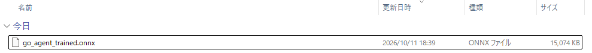
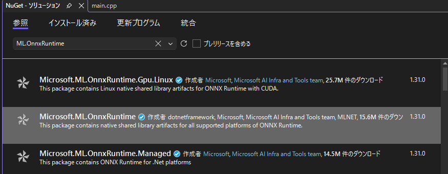
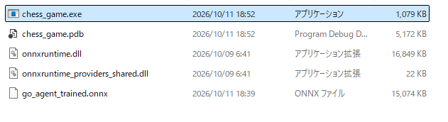
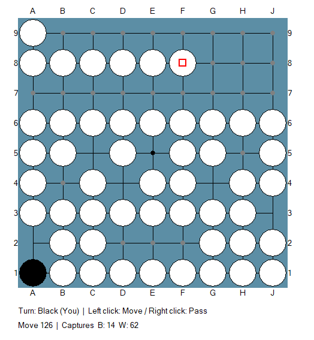

碁の強化学習をC++での続きの話です。
前回碁のAIエージェントの学習アルゴリズムを見直してランダムに対して有利に試合を進めるようになりました。
ということで満を持してC++のゲームに学習したエージェントを組み込んでいきます。

## ptファイルをONNXファイルに変換

変換を行うためコードを作りました。学習で保存した `go_net.pt` から、C++ GUI で読める ONNX を生成できます。

### 手順

前回碁の強化学習エージェントを学習したGoogle ColabのJupyterファイルのセルに以下を張り付けて実行してください。

```bash
pip install onnx onnxruntime        # 検証用 (onnxruntime が無くても変換自体はできます)
!pip -q install onnx onnxruntime

import os, sys
import numpy as np
import torch
import torch.nn as nn
from google.colab import drive, files

# ===== パス設定 (必要なら変更) =====
DRIVE_DIR = "/content/drive/MyDrive/rl_go"
CKPT_PATH = f"{DRIVE_DIR}/go_net.pt"
OUT_PATH  = f"{DRIVE_DIR}/go_agent_trained.onnx"
OPSET = 17
# state_dict だけ保存したファイルの場合のみ使われる (学習時と同じ設定にする)
FALLBACK = dict(preset="base", in_channels=3, value_range=40.0, value_bins=81)
# ===================================

drive.mount("/content/drive")
assert os.path.exists(CKPT_PATH), f"チェックポイントが見つかりません: {CKPT_PATH}"

# GoNet の読み込み: ドライブの go_net.py があればそれを使い、
# 無ければこのノートブック上で定義済みの GoNet / GoNetConfig を使う
sys.path.insert(0, DRIVE_DIR)
try:
    from go_net import GoNet, GoNetConfig
except ImportError:
    assert "GoNet" in globals() and "GoNetConfig" in globals(), \
        "go_net.py がドライブに無く、GoNet もこのノートブックで定義されていません"

# ---- 重みの読み込み ----
ck = torch.load(CKPT_PATH, map_location="cpu", weights_only=False)
if isinstance(ck, dict) and "cfg" in ck and "state" in ck:
    net = GoNet(GoNetConfig(**ck["cfg"]))
    net.load_state_dict(ck["state"])
    print("設定込みチェックポイントを読み込みました")
else:
    f = FALLBACK
    cfg = getattr(GoNetConfig, f["preset"])(
        in_channels=f["in_channels"], value_range=f["value_range"], value_bins=f["value_bins"])
    net = GoNet(cfg)
    net.load_state_dict(ck)
    print(f"state_dict を読み込みました (preset={f['preset']})")
net.eval()
cfg = net.cfg
print(cfg)

# ---- ONNX 出力用ラッパー (policy と value のみ) ----
class OnnxPolicyValue(nn.Module):
    def __init__(self, net):
        super().__init__()
        self.net = net
    def forward(self, state):
        n = self.net
        tokens = n.encode(state)
        R = n.cfg.n_registers
        policy_logits = n.policy_head(tokens[:, R:]).squeeze(-1)    # (B, 81)
        value = n.value_from_logits(n.value_head(tokens))           # (B,)
        return policy_logits, value

wrapper = OnnxPolicyValue(net).eval()
dummy = torch.zeros(1, cfg.in_channels, cfg.board_size, cfg.board_size)
kwargs = dict(input_names=["state"], output_names=["policy_logits", "value"], opset_version=OPSET)

with torch.no_grad():
    try:
        torch.onnx.export(wrapper, dummy, OUT_PATH, dynamo=False, **kwargs)
    except TypeError:                       # dynamo 引数が無い古い PyTorch
        torch.onnx.export(wrapper, dummy, OUT_PATH, **kwargs)
print(f"出力しました: {OUT_PATH} ({os.path.getsize(OUT_PATH) / 1e6:.1f} MB)")

# ---- 検証: PyTorch と ONNX Runtime の出力を比較 ----
import onnxruntime as ort
sess = ort.InferenceSession(OUT_PATH, providers=["CPUExecutionProvider"])
print("入力:", [(i.name, i.shape) for i in sess.get_inputs()])
print("出力:", [(o.name, o.shape) for o in sess.get_outputs()])

rng = np.random.default_rng(0)
max_p = max_v = 0.0
for _ in range(8):
    x = np.zeros((1, cfg.in_channels, cfg.board_size, cfg.board_size), dtype=np.float32)
    for k, c in enumerate(rng.permutation(cfg.board_size ** 2)[: rng.integers(0, 40)]):
        x[0, k % 2, c // cfg.board_size, c % cfg.board_size] = 1.0
    if cfg.in_channels >= 3:
        x[0, 2] = float(rng.integers(0, 2))
    with torch.no_grad():
        tp, tv = wrapper(torch.from_numpy(x))
    op, ov = sess.run(None, {"state": x})
    max_p = max(max_p, float(np.abs(tp.numpy() - op).max()))
    max_v = max(max_v, float(np.abs(tv.numpy() - ov).max()))
print(f"最大誤差  policy: {max_p:.2e} / value: {max_v:.2e}")
print("検証 OK" if max_p < 1e-3 and max_v < 1e-3 else "!! 誤差が大きいです")

# ---- PC にダウンロード ----
files.download(OUT_PATH)
print([f for f in os.listdir(DRIVE_DIR) if f.startswith("go_agent_trained")])
```

### スクリプトがやること

1. **重みの読み込み**: `GoNet.save()` で保存した `.pt` は、ネットワークの設定(層数やサイズ)も一緒に入っています。そのため、モデルの形を指定せずに読み込めます。
2. **出力する部分を絞る**: GUI で使うのは「どこに打つか」と「形勢」だけです。応手予測や補助ヘッドは含めず、ONNX を軽くしています。
3. **入出力名**: `state` / `policy_logits` / `value` で出力します。C++ 側のコードと一致しています。
4. **検証**: onnxruntime が入っていれば、PyTorch と ONNX の出力を比べます。最大誤差が 1e-3 未満なら「検証 OK」と表示されます。

上記を実行するとONNXファイルがダウンロード、ローカルPCに保存されています。



## C++コードの変更
CPPコードに変換が必要です。
元の v2 から変えた点は、大きく3つです。

1. 学習済みのAI（ONNX）を使えるようにした
2. 勝敗がついたらゲームを終えて、結果を表示するようにした
3. 石などが正しく描画されない問題を直した

### 1. 学習済みAIの組み込み

__全体の流れ__

AI の手番になると、次の順で手を決めます。

1. 盤面を、Python の学習時と同じ形の数値（3枚×9×9）に変換します（`BuildObservation`）。
2. ONNX Runtime でネットワークに通し、81マス分の「打ちたさ」の値が返ってきます（`NNAgent::select_move`）。
3. そのうち、ルール上打てるマスだけを候補にして、確率的に1手選びます（`SelectAction`）。

__各部品の役割__

| 部品 | 役割 |
|---|---|
| `BuildObservation` | 盤面を、手番側視点の3枚に変換します。1枚目は自分の石、2枚目は相手の石、3枚目は黒番なら全面1・白番なら全面0です。マスの番号は `y*9+x` で、Python の `行*9+列` と一致します。 |
| `SelectAction` | 打てない手を除外し、温度付きの確率で1手選びます。温度が0なら最も値の高い手だけを選びます。 |
| `NNAgent` | ONNX ファイルを読み込み、推論を実行します。 |
| `LoadAgent` | 起動時に `go_agent_trained.onnx` を探して読み込みます。見つからない、または失敗した場合は警告を出し、従来のランダムAIに切り替えます。 |

__ポイント__

- 打てる手の判定は、C++ 側の既存ルール（コウ・自殺手を除外）をそのまま使います。ネットワークは「候補の中での好み」だけを担当します。
- メニュー画面に、今どちらのAIか（`AI: go_agent_trained.onnx` または `AI: Random`）が表示されます。
- 推論に失敗した場合も、その手だけランダムに打つので止まりません。

### 2. 終局判定と結果表示

__手の処理を1か所に集約__

元のコードでは、人間とAIの処理がそれぞれ別の場所に書かれていました。v3 では次の流れに統一しています。

```
着手 or パス → ApplyMove() → ProcessNextTurn()
```

- **`ApplyMove`**: 盤面への反映、パス回数・手数・捕獲数の更新、手番の交代、終局チェックをまとめて行います。
- **`ProcessNextTurn`**: 手番側に打てる手がなければ自動でパスさせます。次がAIの手番なら、タイマーでAIの思考を起動します。

__終局する条件__

`CheckGameOver` が、手を打つたびに次の2つを調べます。

- 両者が連続でパスした。
- 300手に達した（学習時の打ち切りに合わせた値で、パスも1手と数えます）。

加えて、双方に打てる手がなくなると自動パスが続き、結果的に連続パスで終局します。

__AIのパスの扱い__

学習済みエージェントには「パス」という選択肢がありません。そのままだと、人間がパスしても AI が打ち続けて、ゲームが終わりません。そこで次のルールを入れています。

> 人間が直前にパスし、かつ AI が優勢なら、AI もパスして終局する。

AI が劣勢のときは打ち続け、最終的に300手で終わります。

__結果の表示__

終局すると `FinishGame` が勝敗を計算して結果を保存し、`DrawResultOverlay` が盤面の上にパネルを重ねます。

- 見出しは「You Win! / You Lose… / Draw」です。
- 勝ち幅を表示します（例: White wins by 7.5 points）。
- 黒と白の得点内訳（石、地、コミ）を表示します。
- 捕獲数と終局理由（連続パス、手数上限など）を表示します。
- クリックするとメニューに戻ります。

勝敗の基準は、既存の面積計算とコミです。`WIN_BY_CAPTURES = true` にすると、学習時の報酬と同じ捕獲数での勝負になります。

### 3. 描画まわりの修正

- **石・星・合法手の点**: 元のコードは、ブラシを作っても選択しないまま `Ellipse` を呼んでいたため、黒石が白く描かれたり、点が四角になったりしていました。`FillCircle` という共通関数にまとめて、色と枠を正しく指定しています。
- **ダブルバッファ**: 画面を一度メモリ上に描いてから転送するようにしました。ちらつきが減り、ステータス文字が重なって残る問題も解消します。
- **クリック判定**: 盤の左・上の外側（50px以内）をクリックしても 0 列・0 行目として扱われていたため、除外しました。
- **ステータス表示**: 2行にして、手番、手数、捕獲数、「Black passed」などの通知を出します。

### 4. 調整できる設定値

ファイルの上のほうにまとめてあります。

| 設定 | 既定値 | 意味 |
|---|---|---|
| `MODEL_FILE` | `go_agent_trained.onnx` | 読み込むモデルのファイル名 |
| `AI_TEMPERATURE` | 0.5 | 大きいほど手がばらつく（0で最善手のみ） |
| `MAX_TOTAL_MOVES` | 300 | 手数の上限 |
| `WIN_BY_CAPTURES` | false | true にすると捕獲数で勝敗を決める |

### 5. 変更していない部分

- **盤面エンジン**（`GoBoard`）: 捕獲数を取り出す `get_last_captured_count()` を足しただけで、ルールは元のままです。
- **メニュー画面の基本構成**と、マウス操作（左クリックで着手、右クリックでパス）も変えていません。

なお、コウの判定は元のままです。1子取っただけでコウとして扱う簡易的な実装なので、気になる場合は別途修正をお出しできます。

## 実行

### 実装コード

以下レポジトリのソリューションファイル以下が今回作成した成果物です。

https://github.com/Shinichi0713/Reinforce-Learning-Study/tree/main/physical_engine/chess/chess_game

### 実行手順

レポジトリのソリューションファイルを使って碁エージェントと対決する手順を示します。

__1. プロジェクトを用意する__

1. Visual Studio 2022 で「Windows デスクトップ アプリケーション」(C++) を新規作成します。
2. 自動生成された `.cpp` を削除し、レポジトリにある `GoGUI_v3.cpp` を追加します。
3. 上部のプラットフォームを **x64** にします。

__2. プロジェクト設定__

- **サブシステム**: プロジェクトのプロパティ → リンカー → システム → サブシステムを `Windows (/SUBSYSTEM:WINDOWS)` にします。エントリポイントは `wWinMain` です。
- **C++ 標準**: C/C++ → 言語 → C++言語標準を `ISO C++17` にします。
- **文字セット**: 詳細 → 文字セットを `Unicode を使用する` にします。

__3. ONNX Runtime を入れる__

「ツール → NuGet パッケージ マネージャー → ソリューションの NuGet パッケージの管理」を開きます。`Microsoft.ML.OnnxRuntime` を検索して、プロジェクトにインストールしてください。ヘッダ、ライブラリ、`onnxruntime.dll` は自動で設定・コピーされます。



__4. ONNX ファイルを置く__

`go_agent_trained.onnx` を、exe が出力されるフォルダに置きます。デバッグ実行なら `<ソリューション>\x64\Debug\` です。`.onnx.data` もある場合は、同じフォルダに置いてください。

__5. ビルドして実行する__

1. `Ctrl+Shift+B` でビルドし、`F5` で実行します。
2. メニュー画面の下に **`AI: go_agent_trained.onnx`** と表示されれば、学習済みAIが読み込めています。
3. 先手(黒)か後手(白)を選んで対局します。左クリックで着手、右クリックでパスです。

__うまくいかないとき__

- **`AI: Random (model not loaded)` と表示される**: モデルが見つからないか、読み込みに失敗しています。起動時の警告ダイアログに理由が出るので、ファイルの置き場所を確認してください。
- **`onnxruntime_cxx_api.h` が見つからない**: NuGet のインストールが、このプロジェクトに対して行われているか確認してください。
- **起動時にバージョン関連のエラーが出る**: `C:\Windows\System32` の古い `onnxruntime.dll` が読み込まれている可能性があります。NuGet が出力フォルダにコピーした `onnxruntime.dll` が、exe と同じ場所にあるか確認してください。

AIの強さは、`GoGUI_v3.cpp` 上部の `AI_TEMPERATURE`（既定 0.5、0 で最善手のみ）で調整できます。

### 実際に動作させた

ビルドした上で、Pythonで強化学習したモデルのONNXファイルを実行ファイルがあるフォルダに配置しました。



こんな感じでかなり強めに出来ました。(黒がランダムです。黒がボロボロになりました)
Pythonで強化学習したエージェントをC++で実装することが確認出来ました。



## 総括

今回は、Python/Colab で強化学習した碁エージェントを、C++ の GUI アプリケーションに組み込み、実際に対局できるようにしました。

### やったことの概要

1. **モデルの変換**: 前回までで作成した PyTorch の学習済みモデル（`go_net.pt`）を ONNX 形式に変換。GUI で必要な「policy（着手確率）」と「value（形勢評価）」のみを出力するよう軽量化しました。
2. **C++ への組み込み**: ONNX Runtime を使い、C++ 側で学習済みモデルを読み込み、手番ごとに推論して着手を選択する AI エージェントを実装しました。
3. **ゲームの完成度向上**:
   - 連続パスまたは 300 手で終局し、勝敗結果を画面に表示するようにしました。
   - 石や合法手の描画バグを修正し、ダブルバッファリングでちらつきを解消しました。
   - モデル読み込み失敗時は自動的にランダム AI にフォールバックする仕組みを入れました。

### 技術的なポイント

- **入力の互換性**: Python 学習時と同じく、盤面を「自分の石・相手の石・手番情報」の 3 チャンネルで C++ 側でも構築し、推論結果の整合性を保ちました。
- **着手選択**: 推論結果からルール上打てる手のみを候補に、温度パラメータで調整した確率で着手を選びます。温度 0 で最善手固定、上げるとバリエーションが増えます。
- **終局処理**: 学習時の設定に合わせて 300 手上限を設け、面積法（または捕獲数）で勝敗を判定して結果をオーバーレイ表示します。

### 結果

Visual Studio でビルドし、生成した ONNX ファイルを配置して実行したところ、学習済みエージェントが C++ GUI 上で正常に動作し、ランダム相手に対して圧倒的な強さを示すことが確認できました。Python で学習したエージェントを実アプリケーションに組み込む一連の流れが実証されました。

